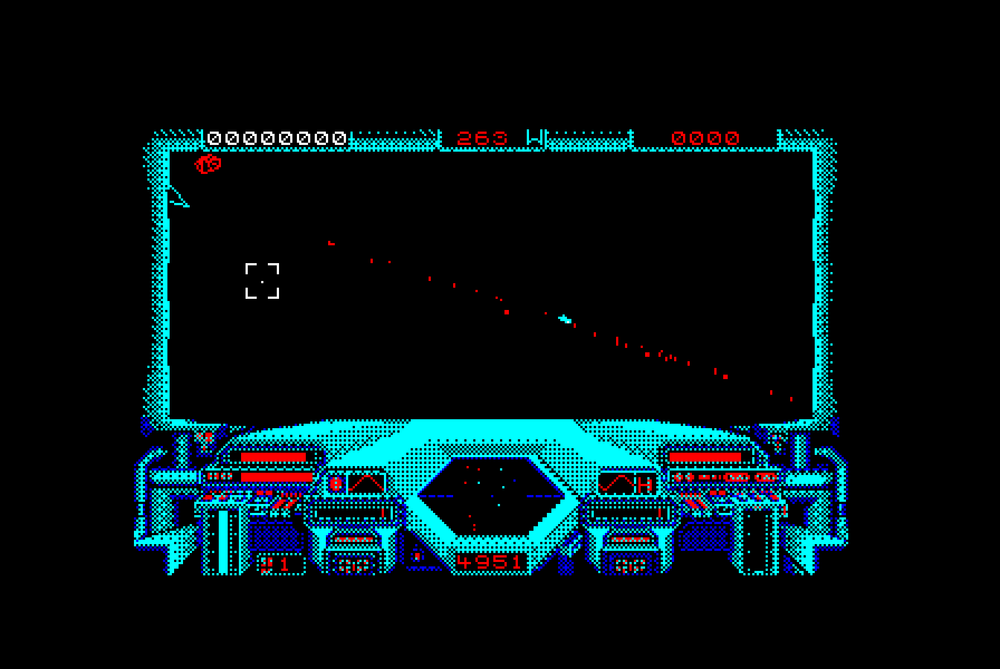

# Starglider on the BBC Master

A port of Argonaut Software's *Starglider* (Atari ST, Rainbird, 1986) to
the BBC Master 128, with Argonaut's blessing.

**[Run it in jsbeeb](https://bbc.xania.org/?autoboot&model=Master&disc1=github:mattgodbolt/starglider-beeb/starglider.ssd)**
(a Master 128), or write `starglider.ssd` to a disc and SHIFT-BREAK a
Master.

The disc is the whole game but for the title song, which is still to be
chosen. It has the title and the credits (any key starts a game, K
redefines the keys), the flight with its panel, sound effects and
Clare Edgeley's speech, docking, Interrogate, the cheat, the level
changes, and at the game's end the pilot rating, the high scores and the
end screen. Esc in play goes back to the title. The game's logic is the
ST's transcribed exactly, drawn in MODE 1 at the ST's 320 x 200 with the
cockpit's own colours below the view, double-buffered, the game stepping
12.5 times a second as the ST's does in flight.

The keys are the ST's:

- the cursor keys, or X and C, bank; cursor up and `;` dive, cursor down
  and `.` climb; SPACE is faster and `/` slower;
- RETURN or COPY fires; L launches a missile, and P picks one up in a
  silo;
- docked, SPACE launches and I interrogates the computer;
- F fixes the sight, Q and S turn the sound off and on, and DELETE starts
  the cheat.

An analogue joystick steers as the ST's mouse does: its fire button
fires, and with the second button held its climb sets the speed.



## How it's being made

It's in 6502 assembly built with
[baron](https://github.com/waitingforvsync/baron), and run the way the
[Chuckie Egg 2](https://github.com/mattgodbolt/chuckie-egg-2-beeb) and
[Ninja Massacre](https://github.com/mattgodbolt/nm) ports were: the
original is the specification, it runs headless as an oracle, and the
port is checked against it in a headless
[jsbeeb](https://github.com/mattgodbolt/jsbeeb).

- The original is the ST version, Argonaut's own. Every version of the
  game was found and studied first (`docs/brief.md`, `docs/research/`):
  the 8-bit ones were other studios' remakes, and ran at about 6 frames a
  second.
- The ST runs headless in [Hatari](https://www.hatari-emu.org/), and its
  renderer is modelled exactly in Python (`tools/st_render.py`), checked
  against every line the ST drew in captured scenes.
- The look is the ST's: colour wireframe, each object's back faces hidden,
  objects see-through to one another.
- The Master's renderer is checked scene by scene against the ST's: what
  the game's logic reads (the lists, the camera-space positions) exactly,
  the lines to within a pixel (`make spike`). It's still slower than the
  ST's.
- `docs/journal.md` has the story so far, and `docs/decisions.md` every
  call the port makes that the original didn't.

## Building

You need [baron](https://github.com/waitingforvsync/baron) 0.6.0 (at
`../baron/build/src/baron`, or on the PATH), Node.js, Python 3 and
[uv](https://github.com/astral-sh/uv). The build reads the ST's program
for its shapes, so `make fetch` must come first; nothing of the original
is committed.

```sh
npm ci          # the jsbeeb harness
make venv       # .venv: SkoolKit, Capstone, Pillow, NumPy
make fetch      # every version of the original, into original/
make            # build/starglider.ssd, and the renderer's test build
make run        # boot the disc in jsbeeb, screenshot to shots/run.png
make check      # the renderer against the ST's on captured scenes, and more
make scenes     # capture the scenes from the ST (needs Hatari built in ../hatari)
```

## Where things are

| Path | What |
|---|---|
| `src/` | the port, in 6502 assembly (`main.6502` builds the disc) |
| `tools/` | the build's generators, the jsbeeb harness, and the tools that run and read the originals |
| `tests/st/` | the scripts that capture scenes from the ST |
| `docs/` | the brief, the journal, the decisions and the research on every version |
| `original/` | where `make fetch` puts the originals |

## Credits

- **Argonaut Software**: the original game ("by Jez San", as its credits
  say), published by Rainbird in 1986.
- **David Lowe**: the music. **Clare Edgeley**: the speech. **James
  Follett**: the novella that came in the box.
- The port's tools stand on
  [Rich Talbot-Watkins](https://github.com/waitingforvsync)'s
  [baron](https://github.com/waitingforvsync/baron),
  [Kieran Connell](https://github.com/kieranhj)'s
  [beeb-port-kit](https://github.com/kieranhj/beeb-port-kit) and
  [jsbeeb-mcp](https://github.com/kieranhj/jsbeeb-mcp), Hatari, SkoolKit and
  Caprice32.
