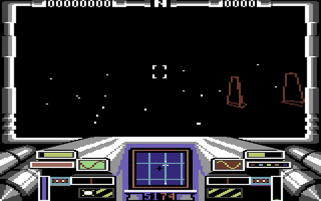
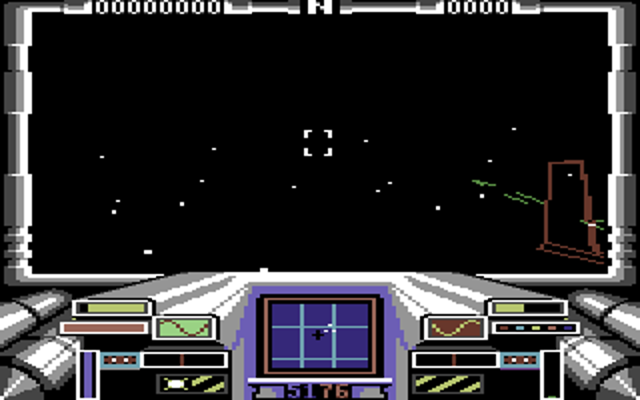
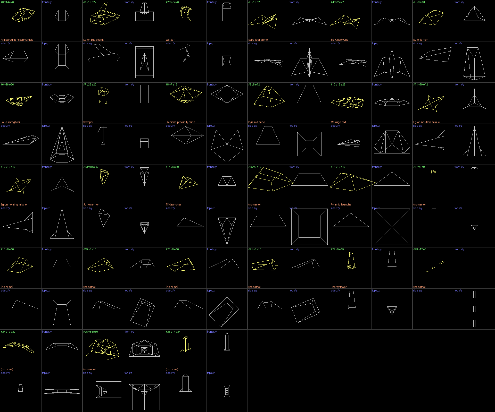

# Starglider on the 6502: Commodore 64 and Apple II (Solid Image)

The only 6502 versions of *Starglider*: Rainbird's Commodore 64 and Apple II
conversions. The code is by C. M. Wong, with "3D graphics by Solid Image
Ltd." The Centre for Computing History says the C64 one "does not do the
machine justice, playing far slower and looking particularly ugly compared to
all the other versions"
([source](https://www.computinghistory.org.uk/det/17319/Starglider/)).
This file covers what the two do, where their time goes, and what a BBC
Master version should take from them or avoid.

Tags:
- **[measured]**: I ran it or read the bytes. The tool or file is named.
- **[source]**: a link.
- **[inferred]**: my reading, with what would check it.

Hex addresses are in each machine's own address space.

Tools, all in `tools/`:
- `c64_d64.py` reads D64 directories and sector chains.
- `c64_unfreeze.py` rebuilds the C64 game's RAM from the disc.
- `c64_run.py` runs and profiles the C64 game on py65.
- `c64_dis.py` is a 6502 disassembler with cycle counts.
- `c64_screen.py` renders the bitmap screen.
- `c64_shapes.py` decodes and draws the shapes, for both machines.
- `a2_disk.py` reads DOS 3.3 discs.
- `a2_image.py` rebuilds the Apple's memory as its loader leaves it.
- `a2_hgr.py` renders a hi-res page.

Images are in `docs/images/c64/` and `docs/images/a2/`.

## Summary

| | Commodore 64 | Apple II |
|---|---|---|
| Credits in the code | "COMMODORE VERSION BY C.M.WONG", "3D GRAPHICS BY SOLID IMAGE LTD." [measured: C64 RAM &66EF, &670F] | "APPLE VERSION BY C.M.WONG", "3D GRAPHICS BY SOLID IMAGE LTD.", "01/02/87 VERSION 2.2" [measured: &8268-&82A6] |
| The image we have | A cracker's compilation disc ("KARATE") holding Starglider as a two-file freezer-cartridge backup, alongside Elite and "LORDS" [measured: `c64_d64.py`] | A DOS 3.3 disc with a 105-byte loader file and seven raw segments. The manual word check is patched out [measured: `a2_disk.py`, `a2_image.py`] |
| CPU | 6510 at 985 kHz (PAL). Bad lines take about 1,000 cycles of each 19,656-cycle frame [inferred: VIC behaviour, modelled in `c64_run.py`] | 6502 at 1.023 MHz, no video DMA |
| Memory | 64K with every ROM banked out (&01 = &25: RAM with I/O at &D000) [measured] | 64K: it needs the language card [measured: segments 1-2 load to &D000-&FCFF] |
| Screen | Multicolour bitmap, 160x200, double-buffered by flipping the VIC bank (&DD00): bitmaps &A000 and &E000 [measured] | Hi-res, double-buffered by flipping pages (&C054/&C055): &2000 and &4000 [measured] |
| 3D view | 144x128 multicolour pixels: 36 cells by 16 character rows, 4,608 bytes [measured: clear at &52B4] | 252x128 hi-res pixels (126 colour pixels): 36 bytes by 128 lines, 4,608 bytes [measured: clear at &1A7A] |
| Clear per frame | Fully unrolled `STA abs,X`: 23,760 cycles, 1.2 frames' worth on its own [measured: cycle count of &52B4] | Same scheme: 23,292 cycles [measured: &1A7A] |
| Line drawer | Divide for the slope, then a fractional accumulator. About 50 cycles a pixel x-major and 40 y-major on the common path. **79 cycles a pixel measured including set-up**, at 14 pixels a line [measured: `c64_run.py`] | Same structure, about 54 cycles a pixel x-major [measured: &0A01] |
| Projection | Log and antilog tables, 8-bit: 168 cycles a coordinate [measured] | Same code |
| Multiply | Turning: fixed 2° steps applied to every vertex, using constant-multiply tables (about 410 cycles a vertex a step). Object rebuild: 16x16 shift-and-add, 640 cycles, nine a vertex [measured] | Same code |
| Hidden lines | Removed in screen space: a face's winding decides it, and an edge is hidden when both its faces face away [measured: &3DB8, &3FE4] | Same |
| Frame rate | **Measured on a model: 4.9 PAL frames a frame (10 fps) with an empty view; 7.8 (6.4 fps) with towers in view; 5.6 to 19 frames, worst while turning.** No sync to the display [measured: `c64_run.py`] | Not measured. Same engine and game code [inferred] |
| Shapes | 27, 18 of them named, 6-34 vertices, 6-50 edges, no animation [measured: `c64_shapes.py`] | The same 27; 25 byte-identical, 2 revised [measured] |
| World | 150 objects in 8-byte records; up to 15 active at once; at most 11 objects and 74 edges drawn a frame [measured: &1C00, &2C1B] | Same engine |
| Sound | SID driver at &C000 on a CIA timer interrupt at about 50Hz: 1,300 cycles a tick, 7% of the CPU [measured] | Speaker toggled through &C030 [measured: eight accesses] |
| Speech | None [inferred: no sample player; the only interrupt is the 50Hz sound tick] | None [inferred] |

## Discs and loaders

### Commodore 64

`original/c64/Starglider.d64` is a standard 35-track image with no error bytes
[measured: `tools/c64_d64.py`]. Its directory is a compilation:

| # | Name | Load | Size | What it is |
|---|---|---|---|---|
| 0 | STARGLIDER | &02C0-&37F9 | 13,626 | Autostart and the first part of the backup |
| 1 | ELITE+ | &0801 | 13,679 | Another game's backup (Elite) [inferred: name] |
| 2 | STAR+ | &0801-&9FFF | 38,911 | The second part of the backup |
| 3 | ELITE | &02C0 | 16,303 | Elite's autostart |
| 4-20 | ALLAN, FANG, ... | &25B3 | 77 each | Elite commander saves [inferred: name and size] |
| 21 | LORDS | &0801-&D7F1 | 53,233 | A third game [inferred: name] |
| 22 | LOADER | &0801 | 1,487 | A menu |

The disc name is "KARATE". 120 sectors on tracks 8-12, 18 and 35 hold data
that no file reaches, probably deleted files [measured].

None of Rainbird's own loader or protection survives. The game is a
freezer-cartridge backup, so the image is a snapshot of a running game
[measured]:

1. `STARGLIDER` loads at &02C0. That overwrites the BASIC vectors (IMAIN =
   &0334), so it autostarts. Its stub at &080D banks out the ROMs, copies its
   own &0900-&68FF to &A000-&FFFF, loads `STAR+` at &0801 and returns into
   it.
2. `STAR+`'s stub moves &0D50-&CEF9 up by &3106 to &3E56-&FFFF. It then
   restores:
   - colour RAM from &0900 (two nybbles a byte);
   - the stack from &0C00 and zero page from &0B00;
   - the 47 VIC registers from &0D00;
   - the CIAs from &0D30 and &0D40;
   - the SID.

   Then it jumps to a decruncher in zero page at &007E, which reads the
   stream from &3E56.
3. The decruncher runs for 3.0M cycles. The freezer's resume code at &0111
   puts zero page &50-&FF back, sets &01 = &25 and RTIs to **&52D3**, the
   middle of the screen clear [measured: `tools/c64_unfreeze.py`].

`c64_unfreeze.py` runs all of this on py65, with the 6510's banking modelled
and ROM reads counted (there are none), and writes the 64K RAM, colour RAM
and I/O state.

### Apple II

`original/apple2/Starglider.do` is DOS order. The VTOC is at T17 S0 with the
catalog at T17 S15, and the free-sector bitmap is all zero
[measured: `tools/a2_disk.py`]. The boot sector is DOS 3.3's own. The one
catalog entry is a binary file, "STARGLIDER", 105 bytes at &0400 (the text
page). It calls DOS's RWTS through &03E3 and &03D9 to read T15 S15, S14 and
S13 to &4100, then jumps there.

The second stage, &4100-&43FF [measured: `tools/a2_image.py`]:
- It sets the reset vector (&03F2) to itself.
- It checks for "CMW" (&C3 &CD &D7, C. M. Wong's initials) at &4000 to tell a
  cold start from a warm one.
- It reads track 28 sector 0, the hall of fame, to &4400, decodes it (EOR)
  into &FE00, and writes it back to disc on a warm start.
- It reads paddle 0 to see whether a joystick is present (&FFEA).

It then loads segments from a table at &42D1. Each entry points at three
bytes: first track, sector count and first page. Sectors are read from 15
down, and the track steps down after sector 0.

| # | From | Sectors | To | Notes |
|---|---|---|---|---|
| 0 | T34 | 32 | &2000 | Hi-res page 1 |
| 1 | T32 | 16 | &D000 bank 1 | Written through &C089 |
| 2 | T31 | 45 | &D000-&FCFF bank 2 | Written through &C081: the engine and its tables |
| 3 | T16 | 16 | &6000, then `JSR &6000` | The manual word check ("Please enter the word at: ..."). On this image &6000 is `JMP &6004` and &6004 is `RTS`, so the check is cracked out |
| 4 | T28 | 1 | &0700 | |
| 5 | T27 | 75 | &4400-&8EFF | The game |
| 6 | T22 | 24 | &0800-&1FFF | The machine drivers |
| 7 | T20 | 32 | &2000 | The cockpit picture |

Finally it moves &4400-&A3FF up to &6000-&BFFF, copies &0700-&0736 to &FFA0
(the random-number table), switches language-card bank 2 in for reading and
writing (&C083) and jumps to &0800. A warm start reloads only segments 5 and
6.

## Memory maps

### Commodore 64, in flight

The code ranges come from `c64_run.py --coverage` over 900 frames of flight;
the tables come from the code that uses them [measured].

| Range | Use |
|---|---|
| &0000-&01FF | Zero page; stack |
| &0200-&07FF | Engine tables of 128 entries. Edge start and end vertices &0201/&0381; edge left and right faces &0501/&0581; next-edge links &0601/&0681; face first edge &0701; vertex clip outcodes &0780. Clipped 2D endpoints per edge in &0280/&0300 and &0400/&0480 |
| &0800-&08FF | Face flags (&0800, bit 6 = faces away); edge flags (&0880, bit 7 = hidden) |
| &0900-&1B2F | Shape directory (27 x 4 bytes at &0900) and the shapes |
| &1C00-&20B1 | World list: an end pointer, then 150 records of 8 bytes |
| &2300-&41FF | Solid Image's 3D engine, with a jump table at &2300-&2336 |
| &4200-&58FF | Drivers and support: the graphics table at &4200, lines &420F/&4221, points &4B3E, instruments &4BC4, flip and clear &5291, text &4523, input &466F-&48DF, vectors &4563 |
| &5900-&8BFF | The game: top loop &5900, frame &5A5E, state and logic up to about &8390 |
| &8C00-&8FE7 | Screen matrix (the colours) for bank 2 |
| &9000-&91FF | Engine object tables: 15 active slots (state &900F, distance &901E/&902D/&903C, position &9078-&90C3, type &90D2, heading &90E1), each object's vertex, edge and face ranges &916F/&917B/&9187, and the camera move queue &9193 |
| &9200-&95FF | Vertex buffer: X &9200/&9280, Y &9300/&9380, Z &9400/&9480 (high and low bytes); screen X &9500, Y &9580 |
| &9900-&9CFF | Constant-multiply tables for the 2° step: x·sin 2° at &9900/&9A00, x·cos 2° at &9B00/&9C00 |
| &9D00-&9FFF | 32·log2(x) at &9D00; antilogs at &9E00 (y and the general divide) and &9F00 (x) |
| &A000-&BF3F | Bitmap B (VIC bank 2) |
| &C000-&C7FF | SID driver (jump table &C000-&C012) |
| &CC00-&CFE7 | Screen matrix for bank 3 |
| &D000-&DFFF | Under the I/O: front-end code and data, and the interrogation texts &D872-&DECF with their pointer table &D84B/&D85D |
| &E000-&FF3F | Bitmap A (VIC bank 3) |
| &FF40-&FF7F | Keyboard matrix |
| &FF80-&FFB6 | The random generator's 55 bytes (&6987: an additive generator, lags 55 and 24) |
| &FFFA-&FFFF | Vectors. The game points all three at an RTI, then IRQ at &62D8 |

Both bitmaps hold a full copy of the cockpit; only the view is cleared.
Double buffering costs two 8,000-byte bitmaps and two screen matrices.

### Apple II, after the loader

[measured: `a2_image.py` and the code's references]

| Range | Use |
|---|---|
| &0800-&1FFF | Drivers: graphics table &0800 (&0809 = points at &119B), line &0A01, input &1209-&12E5, flip and clear &1A63 |
| &2000-&3FFF, &4000-&5FFF | Hi-res pages 1 and 2. Page 2 holds stale copies of the code until it is drawn |
| &6000-&7215 | Shape directory and shapes |
| &7300-&BFFF | The game, the interrogation texts &A3F8-&AA70 and the hall of fame |
| &D000-&EEFF (bank 2) | The engine, with a jump table at &D000-&D036 |
| &EF00-&F5FF | The same constant-multiply tables (&EF00-&F2FF), log table (&F300) and y antilog (&F400) as the C64. The x antilog at &F500 differs (another screen width) |
| &FD00-&FEFF | Hall of fame |
| &FFA0-&FFD6 | Random table |
| &D000-&DFFF (bank 1) | An unpacker at &D00A that reads from &D100 and writes from &4000 [inferred: the cockpit picture for page 2; check by running it] |

## Screen

**C64** [measured: `c64_unfreeze.py` I/O state, &4A24, &5291]:
- &D011 = &3B (bitmap), &D016 = &D8 (multicolour), &D018 = &38.
- The bitmap is at +&2000 and the screen matrix at +&0C00 in whichever bank
  is shown.
- &5291 flips by writing &DD00's low bits: %00 shows bank 3 (bitmap &E000,
  matrix &CC00) and %01 shows bank 2 (&A000, &8C00). &98 holds the draw
  buffer's high byte (&A0 or &E0).
- No code reads the raster (&D012) and no raster interrupt is enabled, so the
  flip lands wherever the beam is [measured: byte search]. The C64 shows one
  torn frame each time [inferred: VIC behaviour].
- In multicolour a line's colour is one of three:
  - %01 takes the matrix's high nybble;
  - %10 takes its low nybble;
  - %11 takes colour RAM.

  The game draws towers brown and missiles green and white, by the object's
  colour code (&9163) [measured: screenshots].

The pictures above come from `c64_run.py` (about flips 480 and 560). The view
spans multicolour x 8-151 and lines 8-135: cells 2-37 of character rows 1-16
(`c64_frozen.png` is the screen as frozen). There is no ground, horizon or
grid, only objects and stars [measured: screenshots].

**Apple** [measured: &1A63, &1A7A, `a2_hgr.py`]:
- &1A63 toggles &C054/&C055, with &98 = &20 or &40 as the draw page.
- The clear writes &80 (the colour-group bit) into bytes 2-37 of lines 8-135.
- The line drawer flips y (191 − y) and plots two-bit colour pixels.
- No code reads &C019 (the IIe's vertical blank), so it doesn't sync to the
  display either.
- The cockpit is the same artwork redrawn in hi-res
  (`docs/images/a2/a2_cockpit.png`).

## Engine

Solid Image's engine sits behind a jump table, at &2300 on the C64 and &D000
on the Apple. Every entry matches at an offset of +&AD00 up to &2DFA, and
+&AD0D to +&AD10 after it. 69% of the bytes from &2300 to &2DF9 are equal at
+&AD00 [measured]. The rest are mostly absolute addresses: the tables and
buffers moved. It is one source assembled twice [inferred].

| C64 | Apple | Routine |
|---|---|---|
| &2300 → &23D5 | &D000 | Initialise the world list |
| &2303 → &2346 | &D003 | Clear the object tables |
| &2306 → &2C91 | &D006 | Fill empty active slots with the nearest inactive world object, scanning the whole list (&2D09, Manhattan distance &2B35) |
| &2309 → &2ABE | &D009 | Distance of each active object |
| &230C → &2BC8 | &D00C | Bubble-sort the active objects by distance |
| &230F → &2C1B | &D00F | Frame budget: at most 11 objects and &4A (74) edges |
| &2318 → &304B | &D018 | Apply the camera move queue (&9193) to every vertex |
| &231B → &3699 | &D01B | Outcodes, projection, stars, clipping |
| &231E → &3DB8 | &D01E | Hidden-line removal |
| &2324 → &2894 | &D024 | Rotate a vertex by a 3x3 matrix |
| &2327 → &414B | &D027 | 16x16 multiply |
| &232D → &3410 | &D02D | Perspective divide |
| &2330 → &2DDF | &D030 | Rebuild the next object in turn |
| &2336 → &2669 | &D036 | Build an object into the vertex buffer |

### How the world is held [measured: &304B-&33F1, &2669, &2894]

- **The vertex buffer holds the world in camera space.** It has room for 127
  vertices (the count in &02 is checked with BVS), 16 bits per axis.
- Each object's vertices are built there when it is activated or rebuilt
  (&2669). That takes:
  - the object's position less the camera's, in range only if the high byte
    is within ±&1E;
  - one of four headings, applied to the shape's signed-byte vertices by
    negating and swapping axes;
  - the full camera matrix, through &2894: nine multiplies at &414F, a signed
    16x16 shift-and-add with a 14-step loop at **640 cycles a multiply**.
    That is about 6,000 cycles a vertex.
- **When the ship turns,** the game queues the angle (&9193) and &304B
  rotates every vertex in the buffer about one axis in **2° steps**,
  repeating the step for larger angles.
  - The step multiplies through tables (&33F4: x·sin 2°, factor 0.0349;
    &3402: x·cos 2°, factor 0.9995). Each product is two lookups and an add,
    about 20 cycles.
  - A whole step costs about 410 cycles a vertex, or 22,800 cycles for the
    47 vertices in the buffer during the test [measured: `c64_run.py`].
  - Moving the ship adds a 16-bit offset to every vertex (&314F).
- The incremental rotation drifts, so &2DDF rebuilds one object a pass
  through the full-precision path. The game calls it once every four frames.

### Per frame [measured]

**Outcodes and projection** (&3699): each vertex gets clip codes against a
45-degree frustum (|x| ≤ z, |y| ≤ z) in &0780. Visible ones are projected by
**&3410**:
- It shifts x and z right by z's magnitude until both fit in a byte.
- It looks up 32·log2 for each (&9D00) and subtracts.
- It reads the antilog (&9F00 for x, &9E00 for y) and adds the centre: x =
  79 ± d, y = 128 ± d.

That is 168 cycles a coordinate [measured], with 8-bit precision.

**Stars**: the engine plots eight points made from sums and differences of
three basis vectors (&375F-&37E6); the game plots about 13 more (&706B, then
&4B3E).

**Clipping** (&398D) is done in 3D, against the frustum planes. The
intersection fraction comes from the same log-table divide (&3579) and is
applied with a short multiply (&4031/&4098).

**Hidden lines** (&3DB8, &3FE4) are worked out in screen space:
- For each face, it walks the face's edges through the next-edge links and
  tests the winding of the projected vertices. Two 8-bit divides compare
  slopes (&3F34).
- It sets &0800 bit 6 on faces that face away.
- An edge is hidden (&0880 bit 7) when both its faces face away.

The ST draws the edges of visible faces too (see `tools/st_shapes.py`), so
both remove hidden lines.

**Edges** (&7027-&7065) are drawn one at a time from the clipped endpoints,
in the object's colour, through &420F. A shared vertex is projected once but
each edge does its own line set-up.

**Lines** (&420F → &4221, C64):
- Entry flips y (Y = 199 − y). Coordinates are multicolour x 0-159 and y
  0-199, with the colour in &2D.
- It computes |dx| and |dy|, then the slope fraction with an eight-step
  shift-and-subtract divide.
- One of four loops runs. Each is self-modified with `ADC #slope` and ORs a
  mask (table &443B ANDed with the colour pattern &443F) through (&2F),Y.
- Common path, from the cycle counts in `c64_dis.py`:
  - x-major (&42B6): 50 cycles a pixel, plus 19 at each new byte (every 4
    pixels) and 4 when y steps;
  - y-major (&43AD): 40 cycles a pixel, plus 14 when x steps and 16 at each
    new character row.
- **Measured: 79.4 cycles a pixel including set-up and call, at 14.4 pixels
  a line.** That leaves roughly 390 cycles a line for set-up [inferred from
  the two figures].
- The Apple's &0A01 has the same structure (divide, then accumulator) with
  two-bit pixels: 54 cycles a pixel on the x-major common path.

**Clear** (C64 &52B4 inside &5291): 144 passes of 32 `STA abs,X` (two per
character row, 16 rows) plus `DEX`/`BNE`. That is 144 x 165 = 23,760
cycles for 4,608 bytes (5.2 cycles a byte). A second, smaller form (&531C:
cells 11-28 of rows 5-12) runs when &AC is negative. The Apple's &1A7A is
128 `STA abs,X` per pass, 36 passes: 23,292 cycles.

**Instruments** (&4BC4), every frame into the draw buffer:
- scroll the two oscilloscope traces (ROR/ROL across three bytes by eight
  rows);
- redraw the scanner grid with the general line drawer (&4A6F, four or five
  lines);
- plot the blips (&4ADE, about ten).

The score and readouts are redrawn separately, through &4523 (about 20
characters a frame from &679F, &67F3, &6CC9 and &548A: about 4,800 cycles).

### Main loop and pacing [measured: &5900-&59F2, &62D8-&634E]

The top loop (&5949-&59D2) runs four frames per pass, each a call to &5A5E.
Engine and game work is spread between them:

| After | Work |
|---|---|
| Frame A | Engine and game updates (&2312, &6936, &2315, &69BB), distances (&2309), sort (&230C), more logic (&8023), energy warnings |
| Frame B | &6AEE, then **the world scan (&2306)** |
| Frame C | Logic, distances and sort again, then the edge budget (&230F), which repeats frame C until the scene fits |
| Frame D | **One object rebuild (&2330)** |

The frame routine &5A5E calls, in order:
- the game updates (&6953, &47E4 input, &734F, &77C6);
- the camera move (&2318);
- projection (&231B) and hidden lines (&231E);
- more game updates (&548A, &6CC9, &679F, &67F3, &6CB6, &6BE3);
- then it jumps to &6FD1, which draws the stars, the instruments (&4BC4), the
  edges (&7027), and **flips and clears** (&5291).

Nothing waits for the display: the next frame starts as soon as the clear
ends.

The interrupt is CIA1:
- Timer A counts 1,000 cycles.
- Timer B counts 20 of timer A's underflows (9 when &C6 is set), giving
  49.3Hz (or 109Hz) on a 985 kHz PAL machine.
- It calls the sound driver (&C006, or &C009) and nothing else.

## Cost model: where the C64's frame goes

`c64_run.py` resumes the frozen game on py65 and models:
- CIA1's timers and interrupt;
- 40-cycle bad lines on 25 lines a frame;
- an idle keyboard, or a script of joystick presses.

It charges every cycle to the innermost subroutine and counts bitmap writes.
py65's cycle counts include taken branches and page crossings [measured: a
test of `BNE` and `LDA abs,X`]. Sprite DMA isn't modelled (sprites are off:
&D015 = 0).

Frame times (flip to flip, including the work between frames):

| Run | Wall cycles a frame | PAL frames | Frames a second | CPU cycles |
|---|---|---|---|---|
| Resume, empty view, 59 frames | 96,102 (74,257-130,992) | 4.89 | 10.2 | 91,209 |
| Flips 451-700, energy towers and missiles in view, no input | 153,899 (109,312-303,283) | 7.83 | 6.4 | 146,069 |
| Flips 451-900, steering and firing | 160,087 (up to 379,890) | 8.14 | 6.1 | 151,943 |

The frame times repeat in a four-frame pattern: the world scan and the
rebuild land in particular frames. Turning frames are the worst
[measured: per-frame list in `run*/profile.txt`].

Where the 146,069 CPU cycles of an average frame went, flips 451-700. These
are inclusive figures, and each includes any interrupt that landed inside it:

| Work | Routine | Cycles a frame | Share |
|---|---|---|---|
| Screen clear | &5291 (in &5A5E's own time) | 23,800 | 16% |
| Outcodes, projection, clipping, engine stars | &231B | 30,700 | 21% |
| ...of which perspective divides (72 a frame) | &3410 | 12,100 | 8% |
| Instruments: scanner grid and blips, traces | &4BC4 | 16,600 | 11% |
| One object rebuild every 4th frame (about 65,000 each) | &2330 → &2669 → &2894 | 16,100 | 11% |
| World scan every 4th frame (about 45,000 each, 150 objects) | &2306 → &2D09 | 11,200 | 8% |
| 3D edges (11.8 lines) | &420F | 10,600 | 7% |
| Sound interrupt (about 7.7 ticks a frame, 1,300 each) | IRQ → &C006 | 10,200 | 7% |
| Hidden lines | &231E | 8,400 | 6% |
| Game logic, text readouts (about 4,800), game stars, input, other housekeeping | rest | about 18,000 | 12% |

When steering, the camera move (&2318 → &3204) costs about 22,800 cycles per
2° step. A turn of several degrees in one frame multiplies that.

So the C64 is slow for these reasons:
1. **The clear alone is 1.2 frames.** The whole view is erased with
   `STA abs,X` every frame, whatever is on it.
2. **The instruments are redrawn every frame:** scanner grid lines through
   the general line drawer and scrolled traces, plus about 20 characters of
   text.
3. **Precise maths in the wrong places.** Rebuilds use a 640-cycle
   shift-and-add multiply nine times a vertex, and every 2° of turn
   re-rotates every vertex in the buffer, visible or not.
4. **Uneven pacing.** The world scan and the rebuild land in particular
   frames of the four. With no sync to the display, the frame time wanders
   between 5.6 and 19 frames.
5. **The line drawer is mediocre but not the problem**: 7% of the frame, at
   79 cycles a pixel.

The 3D work proper (projection, clipping, hidden lines and lines) is about a
third of the frame [measured: the table's &231B, &231E and &420F rows].

The Apple runs the same code on a 1.023 MHz CPU with no video DMA. It pays
for paddle reads instead (11 cycles a count, about 1,400 an axis at centre,
two axes) and for speaker loops while sound plays. Its frame rate is probably
within 10% of the C64's [inferred: not run; an Apple harness on py65 would
check].

## Shapes

`c64_shapes.py` decodes the format from the engine's loader (&24CE/&2507) and
vertex reader (&277C) [measured]:

- **Directory** at &0900 (C64) or &6000 (Apple): 27 entries of four bytes,
  two offsets from the base. The engine takes the second offset for variant 5;
  every entry here has both the same.
- **Shape header**:
  - vertex, edge and face totals, checked against the buffers;
  - two bytes the loader skips, which look like a bounding radius (ATV &00A6
    = 166 against an extent of 160; energy tower &0235 = 565 against 560)
    [inferred];
  - the part count (one part, except the silo's two);
  - per part, eight bytes: the part's offset, three bytes kept in &31-&33
    (always 0), and shift counts for X, Y and Z.
- **Part**: nv, ne, nf; nf face bytes (each face's first edge); ne edge start
  vertices; ne edge end vertices; ne left faces; ne right faces; nv vertices
  as three signed bytes, each shifted left by its axis's count; ne next-edge
  links for the left face; ne for the right. Indices are 0-based within the
  part. Y is up (bases at y = 0) and Z forward.
- **Names**: the interrogation screen's index (&5C80) is the shape number. It
  writes index x 4 as the type byte of the object it shows (&5FA0-&5FA5) and
  looks the text up in the split pointer table at &D84B/&D85D (&610A).

`docs/images/c64/c64_shapes.png` is the contact sheet; each tile shows a
perspective view and front, side and top views. There is one PNG per shape
(`c64_shape_NN.png`).

| # | Name | Vertices | Edges | Faces | ST shape (vertices/edges, frames) |
|---|---|---|---|---|---|
| 0 | Armoured transport vehicle | 14 | 26 | 15 | 8: 16/28 |
| 1 | Egron battle tank | 19 | 27 | 14 | 9: 24/38 |
| 2 | Walker | 27 | 26 | 9 | 1: 22/42, 16 frames |
| 3 | Starglider drone | 19 | 28 | 12 | 7: 16/30, 9 frames |
| 4 | StarGlider One | 22 | 22 | 7 | 27: 24/41, 37 frames |
| 5 | Bute fighter | 9 | 13 | 8 | 13: 10/23 |
| 6 | Lotus starfighter | 16 | 26 | 13 | 21: 13/23 |
| 7 | Stomper | 25 | 20 | 7 | 15: 28/43, 29 frames |
| 8 | Diamond proximity mine | 7 | 15 | 11 | 14: 10/24 |
| 9 | Pyramid mine | 8 | 12 | 7 | 2: 8/12 |
| 10 | Message pod | 18 | 28 | 14 | |
| 11 | Egron neutron missile | 10 | 12 | 5 | 24: 9/15 |
| 12 | Egron homing missile | 10 | 12 | 5 (the same as 11) | 25: 15/22 |
| 13 | Juno cannon | 10 | 15 | 8 | 20: 10/15 |
| 14 | Tri-launcher | 6 | 10 | 6 | 23: 18/21 |
| 15 | (no name) | 9 | 12 | 7 | |
| 16 | Pyramid launcher | 12 | 12 | 1 | 26: 8/12, 35 frames |
| 17 | (no name: 6 vertices at height 560-608, the top of a tower) | 6 | 9 | 6 | |
| 18-21 | (no name: one 8-vertex wedge at four rotations) | 8 | 10 | 6 | |
| 22 | Energy tower | 9 | 15 | 9 | 4: 16/28 |
| 23 | (no name: three dashes along Z on the ground) | 12 | 6 | 1 | |
| 24 | (no name: a flat winged shape) | 12 | 22 | 13 | |
| 25 | (no name: two parts, likely the silo) | 34 | 50 | 2 | |
| 26 | (no name: a tall rocket shape) | 17 | 24 | 1 | |

The ST figures are from `tools/st_shapes.py` (another agent's tool), run on
`AUTO/STAR.PRG` [measured].

- **The 6502 models are Solid Image's own, not the ST's.** Most have fewer
  edges, and only the pyramid mine and the Juno cannon match the ST's counts.
- None is animated. Every directory entry's two offsets are equal, and the
  shape bytes don't change over 700 frames of play [measured: `c64_run.py`
  RAM before and after].
- The ST animates its walker, stomper, drone, StarGlider One and pyramid
  launcher.
- The ST's 125-vertex title logo has no 6502 counterpart.
- The Spectrum's models weren't available to compare yet (no `zx.md`).

The Apple's shapes are the same set: 25 of 27 are byte-identical
[measured: `c64_shapes.py --base 6000`]. The two that differ, in
`docs/images/a2/`:
- tank #1 has 25 edges (two fewer hull lines);
- message pod #10 is larger (shift 4 rather than 3), with 16 vertices and 27
  edges.

## The game

From the strings and tables [measured: strings in both images]:
- **Objects:** the 18 named types above, in a world of 150 placed objects:
  16 ATVs, 14 tanks, 4 walkers, 4 drones, 1 StarGlider One, 7 Bute, 5 Lotus,
  2 stompers, 10 diamond mines, 10 pyramid mines, 1 message pod, 8 Juno, 8
  tri-launchers, 7 pyramid launchers, 18 energy towers, 1 silo, and others
  [measured: &1C02 records]. Each record is type x 4 + heading (0-3), the
  active slot (&FF when inactive), then three 16-bit coordinates.
- **The interrogation computer** ('I'): the name and two lines of text for
  each type ("PYRAMID MINE / DANGER! AVOID PROXIMITY MINES...") beside the
  model.
- **The mission:**
  - "SENTINEL REPORTS EGRON MESSAGE POD HAS ENTERED THIS SYSTEM... INTERCEPT
    THIS DEVICE";
  - "MESSAGE POD CONTAINED AGAV BLUE PRINTS. PLANS REVEAL AGAV 4-MISSILE
    CAPABILITY MECHANISM NOW FITTED";
  - silos and docking: "REPORT TO SILO", "DOCKING COMPLETE / LASERS AND
    SHIELDS REPLENISHED", "SILO LAUNCH";
  - refuelling at towers: "ENERGY CELLS REFUELLING";
  - mines: "MINE DETECTED", "MINE DETONATED";
  - "LEVEL 1" (C64) and "LEVEL 01" (Apple); "YOU HAVE MANUAL CONTROL".
- **Key redefinition:** fire lasers, accelerate, decelerate, fire missile.
- **Hall of fame**, with default names CHING, GLYN, JOEY, SOLID IMAGE,
  ARGONAUT SOFTWARE and RAINBIRD. The Apple saves it to disc ("PRESS 'H' TO
  SAVE HI-SCORES").
- The C64 reads joystick port 2 (&DC00) and the keyboard (&4830 table). The
  Apple reads the paddles as a digital stick (&C064/&C065, thresholds &3C
  and &8C), with buttons at &C061.

Cut against the ST:
- **No speech or samples** (Clare Edgeley's speech is in the ST and Spectrum
  128K) [inferred: no sample player, only a 50Hz sound tick; checking the
  SID driver's data would confirm];
- **no shape animation** [measured];
- **simpler models** [measured];
- no 3D title logo [measured];
- the view is about 144x128 multicolour pixels in a fixed cockpit.

The birdsanctuary.co.uk catalogue credits the C64 tape release to C. M. Wong
(code) and Glyn Williams (graphics)
([source](https://birdsanctuary.co.uk/starglider/5/),
[source](https://birdsanctuary.co.uk/starglider/2/), via a web search
summary: both pages returned 503 when fetched, so recheck them). GLYN in the
default hall of fame fits that credit [inferred]. Wikipedia says Solid Image made
the C64 and "Apple IIGS" versions
([source](https://en.wikipedia.org/wiki/Starglider)). Our Apple disc is an
8-bit hi-res version that needs 64K, not a IIGS one [measured].

## The two versions share everything but the drivers

[measured]
- **Engine:** the same Solid Image code, relocated (&2300 to &D000) with the
  same jump table.
- **Game:** the same source reassembled with zero page and addresses moved.
  The C64 frame routine &5A5E and the Apple's &7695 run the same instruction
  sequence (&0B/&0C become &09/&0A). The start, &5900 against &7532, is the
  same order of calls.
- **Machine interface:** the same graphics table: C64 &4200 (&420C → &5900
  start, &4209 points) against Apple &0800 (&080C → &7532, &0809 points).
- **Author:** one, C. M. Wong ("CMW" is the Apple loader's signature).
- **Version:** the Apple says "VERSION 2.2, 01/02/87"; the C64 has no version
  string.
- **Data:** the same shapes (25 of 27 identical), texts and tables.
- **Machine-specific:** the screen drivers (bitmap layout, line drawer,
  clear, flip), input, sound and the loaders.

## What a BBC version should take from them

The BBC Master's 65C02 at 2 MHz with no video DMA has about 40,000 cycles a
50Hz frame, about twice the C64's 18,600 [inferred: clock rates and bad
lines]. A straight transcription of this engine would run at about 13 fps
(146,000 cycles at 2 MHz is 73 ms), twice the C64's rate. The design
choices below matter more than the clock.

**Worth reusing:**
- **The log/antilog perspective divide.** 168 cycles a coordinate, and
  8-bit precision is enough for a view of about 150 pixels. Three
  256-byte tables (32·log2 and two antilogs) [measured]. The CPC version
  also keeps logarithm and quarter-square tables [source: the notes in
  another agent's `tools/cpc_shapes.py`].
- **The budget.** At most 15 objects active, nearest first; at most 11
  objects and 74 edges drawn. A hard cap is how a 6502 keeps frame time
  bounded [measured: &2C1B].
- **Hidden lines from projected winding.** No 3D normals: the faces' winding
  on screen decides it, after projection, which the engine needs anyway
  [measured: &3DB8].
- **The 2° constant-multiply step** is cheap per vertex (about 20 cycles a
  product). The idea of a table per fixed factor carries over even if the
  world-buffer scheme doesn't.

**Worth avoiding:**
- **Clearing the whole view every frame.** 23,800 cycles for 4,608 bytes.
  With 10-20 lines of about 15 pixels, erasing last frame's lines (redrawing
  them in the background colour, or EOR) or clearing only the rows they
  touched costs a fraction of that [inferred: 230 pixels at about 25
  cycles]. The BBC's equivalent view in MODE 1 is a similar size, so this
  one decision is worth as much as everything else.
- **Redrawing static instruments every frame** (16,600 cycles): update them
  when they change, and only in the buffer that is stale.
- **Rotating every vertex in the world when the ship turns** (22,800 cycles
  a 2° step, for objects off screen too). Rotate only drawn objects, once a
  frame, from their model vertices with a per-frame matrix. Use quarter-square
  multiplies (tables, about 40-50 cycles for 8x8), not the 640-cycle
  shift-and-add.
- **Lumpy pacing.** The world scan (45,000 cycles) and the rebuild (65,000)
  land in particular frames, and nothing syncs to the display, so the frame
  time wanders by 3.5 times. Spread the work (scan a few objects a frame) and
  pace on VSync with a fixed frame count.
- **Each edge doing its own divide.** About 390 cycles of set-up a line
  [inferred]. Bresenham needs no divide. A MODE 1 or 2 drawer with byte-mask
  tables and unrolled octants should beat 50 cycles a pixel by about two
  times [inferred: the beeb line-drawer benchmark (`tools/beeb_linebench*`,
  another agent's) will give the figure].
- **The sound interrupt** at 1,300 cycles a 50Hz tick is 7% of the C64; an
  SN76489 driver should be far cheaper [inferred].

**The models:** the original, the ST, is the specification (rule 1). These
are a simplified re-modelling (fewer edges, no animation). They are a ready
low-detail set if the Master can't afford the ST's 30-54 edge models, but
using them would be a numbered decision.

## Open questions

1. **Rainbird's own C64 loader and protection.** We have only a freezer
   backup off a compilation. An original-release image (TOSEC or tape) would
   show the original loader and whether the frozen game differs from a cold
   start (it was frozen mid-flight, at the start of a game).
2. **The Apple's frame rate** is estimated, not measured. A py65 harness with
   the language card, the paddles (timed reads) and keyboard soft switches,
   driven from &0800 through the title screen, would check it.
3. **The unnamed shapes**:
   - 15, 17, 18-21, 23, 24 and 26;
   - 25, probably the silo, and 23, probably runway or monorail markings.

   Poke &5C80 in the interrogation screen to show each, or find them in the
   world list by position.
4. **The header's two skipped bytes** (bounding radius?) and the per-part
   bytes kept in &31-&33 (always 0 here): find their readers.
5. **Missions beyond the first.** Only "LEVEL 1" appears as text. Whether
   later levels change the world list (the ST's do?) needs a run past the
   message pod.
6. **The timing model.** Bad lines are modelled at 40 cycles; CIA timing and
   sprite DMA are approximate. A few frames checked against VICE would bound
   the error, which should be a few per cent at most [inferred].
7. **The sound:** what the SID driver plays in flight (effects only, or
   music) and its data format, if the port wants the C64's effects as a
   reference.
