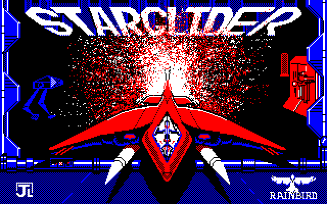
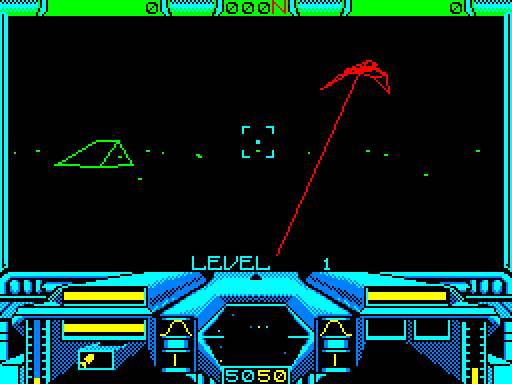
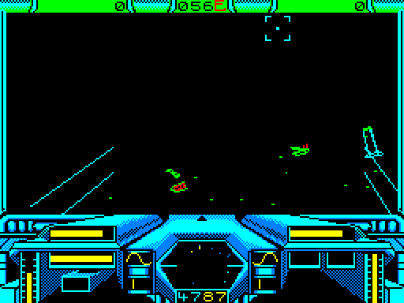
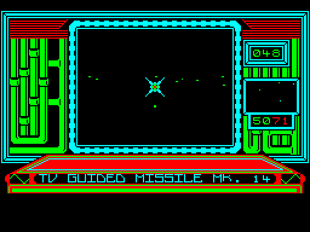
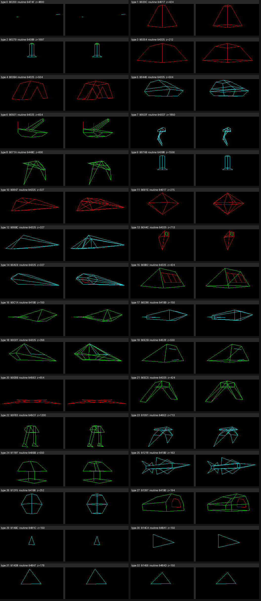
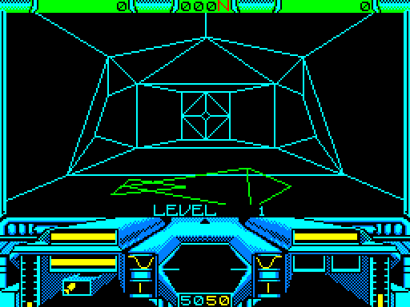
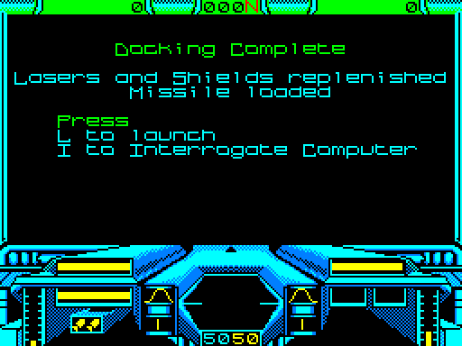
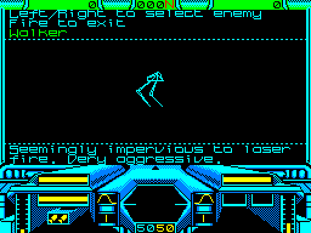
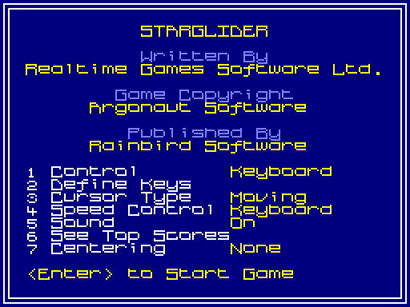
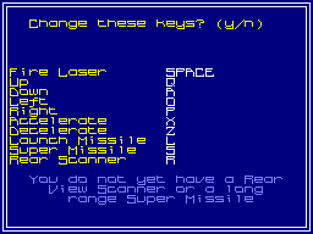

# Starglider on the Amstrad CPC (Realtime Games, 1987)

The CPC version is a Realtime Games conversion (the team behind the
Spectrum version), published by Rainbird. Its display is the closest of any
version to the BBC's: a 6845 CRTC, MODE 1 at four colours, and a screen
narrowed to 256 x 192. This file covers the disc in `original/cpc/`, the
memory map, the screen, the engine, the shapes and the game.

Tags: **[measured]** means a tool here ran it or read the bytes;
**[source]** gives a link; **[inferred]** is a reading, with what would check
it. Addresses are in the CPC's address space.

The tools are `tools/cpc_*.py`. Run them from the project root with
`.venv/bin/python -I -B`. `cpc_emu.py` needs a Caprice32 checkout with the
harness patch described under "The emulator".

## Summary

| Item | Value |
|---|---|
| Disc image | Extended DSK, 40 tracks, 1 side, 9 x 512-byte sectors (&C1-&C9, AMSDOS DATA format), no non-standard sectors **[measured: cpc_dsk.py]** |
| Files | `STARGLID` (BASIC, 172 bytes), `LOADPIC.SCR` (16K to &C000), `K32.BIN` (32K to &2000), `K16.BIN` (16K to &C000) **[measured]** |
| What the disc is | A memory dump of the game made after it loaded, not Rainbird's protected original. A stub at &F700 puts the pieces back in place and jumps to &14F4 **[measured]** |
| Machine | Runs in the base 64K. RAM configuration &C0 throughout; the 6128's second 64K isn't used **[measured: harness `regs`]** |
| Code | &14F4-&75C5 (24,786 bytes, with its strings and small tables), plus the front end in &B600-&B7FF. Profiles reached 8,139 instruction addresses **[measured]** |
| Shapes | &0200-&14F3 (4,852 bytes): 33 records (types 0-32) via the pointer table at &8F15 **[measured]** |
| World | 128 objects of 20 bytes at &7600-&7FFF, rebuilt per level **[measured]** |
| Screen | MODE 1 (4 colours). CRTC R1 = 32 and R6 = 24, giving **256 x 192**. Each buffer uses 1,536 bytes per raster bank (12,288 in all) **[measured]** |
| Double buffer | Buffers at &8000 and &C000, swapped by writing CRTC R12 = &20 / &30 at &22A4. It then waits for VSync **[measured]** |
| Spare RAM in the screens | The last 512 bytes of each 2K raster bank (8 x 512 per buffer). They hold the sine, square and log tables, the font, the vertex buffer, the variables and the stack **[measured]** |
| 3D view | 256 x 128 (character rows 1-16, lines 8-135), cleared every frame with PUSH in 17.0 ms. The missile camera view is 128 x 96 **[measured]** |
| Panel | Row 0 is an 8-line status bar; rows 17-23 are the 56-line cockpit panel **[measured]** |
| Colour | Black plus three line colours: bright red, bright green and bright cyan by default, and player-editable. A raster split at line 136 gives the panel yellow, bright cyan and sky blue. The split is a busy-wait inside the fifth 300Hz interrupt **[measured]** |
| Lines | A Bresenham line drawer at &1DE5 takes each scanline step with a POP from a 256-byte table at &F700 or &FF00. It costs about 20 us per pixel on x-major runs and 23 us on y-major runs **[inferred from the instruction timings]** |
| Hidden lines | Back-face culling per face; an edge is drawn when any of its faces is front-facing **[measured: the original's own drawing, cpc_shapes.py]** |
| Maths | 8-bit sine (512 steps a turn); 8 x 8 multiplies from a table of squares; division by logarithm and exponent tables **[measured]** |
| Frame rate | Quiet flight: 7-13 frames per update, mean 8.3 (6.1 fps). Long play: mean 8.9 (5.6 fps). Firing among several objects: 12-18 frames (3.1 fps) **[measured: cpc_fps.py]** |
| Time per update (quiet flight) | 160.6 ms. Multiplies 22.7 ms, clear 17.0, object pass 12.7, behaviour 10.3, VSync wait 8.9, interrupts 8.7, drawing lines only 2.6 **[measured: cpc_profile.py]** |
| Sound | AY sound effects, all 14 registers rewritten from a shadow copy. There is no music or speech **[measured: port log]** |




## The emulator

Caprice32 (https://github.com/ColinPitrat/caprice32, at
`/home/matthew/dev/caprice32`) built cleanly with `make APP_PATH="$PWD"`. It
bundles Amstrad's ROMs **[measured]**. It runs headless with
`SDL_VIDEODRIVER=dummy`, at about 800 frames a second **[measured]**.

A small patch adds a research harness (search for "harness" in `src/cap32.cpp`
and `src/z80.cpp`):

- `CAP32_PORTLOG=path` logs every OUT to the gate array, the CRTC and the PPI,
  as `frame scanline pc port value`.
- `CAP32_SCRIPT=path` runs `FRAME OP ARGS` lines at the end of a frame. The
  operations are key down and up (keyboard matrix row and bit), a screenshot,
  a RAM dump, a snapshot, a poke, a register dump, exit, and an execution
  profile (per address, instructions started and microseconds spent).

`tools/cpc_emu.py` wraps the harness in the step language of
`../porting-to-the-beeb.md`: `f60`, `@1000`, `RETURN:tap`, `X:down`,
`!shot:name`, `!ram:name`, `!poke:F636=01`, `!covon`, `!cov:name` and so on.
It boots the disc by typing `RUN"STARGLID`, so the same steps give the same
frames every run **[measured: run 5 replayed run 2 and got the same flips]**.
The game takes over at frame 632, and the menu is up by frame 900.

## Disc and loader

**The image** **[measured: tools/cpc_dsk.py]**:

- It is an extended DSK written by Caprice32, with 40 tracks on one side.
- Every track has nine 512-byte sectors, &C1-&C9, interleaved
  C1 C6 C2 C7 C3 C8 C4 C9 C5.
- There are no odd sizes, IDs or FDC error flags.

`cpc_dsk.py` reads standard and extended images in the DATA, SYSTEM and IBM
formats. It lists the AMSDOS directory and each file's header, and extracts
each file both with and without its 128-byte header.

| File | Attributes | Type | Load | Length | Blocks |
|---|---|---|---|---|---|
| `STARGLID` | R | BASIC | &0170 | 172 | 2 |
| `LOADPIC.SCR` | R S | binary | &C000 | 16,384 | 3-19 |
| `K32.BIN` | R S | binary | &2000 | 32,768 | 20-52 |
| `K16.BIN` | R S | binary | &C000 | 16,384 | 53-69 |

**The BASIC loader** **[measured: detokenised by hand from `STARGLID`]**:

```
10 MODE 1
20 INK 0,26:INK 1,0:INK 2,6:INK 3,2
30 REM k32 loads to 8192 for 32768
40 REM k16 loads to 49152 for 16384
50 LOAD"loadpic.scr"
60 MEMORY &1FFF
70 LOAD"k32"
80 LOAD"k16"
90 CALL &F700
```

The loading picture goes straight into the screen at &C000, and `K16`
overwrites it. That, and the REMs, mark this disc as a transfer of the
running game, not Rainbird's release. The original's protection, if it had
any, isn't on this image **[inferred: compare a protected original if one
turns up]**.

**The stub at &F700** (inside `K16`) **[measured: sna2skool]**:

1. `DI`.
2. Copy &8000-&9FFF to &0000-&1FFF. `K32`'s last 8K is the game's low 8K.
3. Copy seven 512-byte pieces from &C040 + n x &800 to &8600 + n x &800, for
   n = 0-6. These are the front end, the shape table and the enemy
   encyclopedia. They live in the unused tails of the &8000 buffer's raster
   banks, and the dump had parked them in the &C000 screen.
4. `JP &14F4`.

**Start-up at &14F4** **[measured]**:

- It sets SP = &FEB0 and calls &1558, which programs the CRTC (R7 = &1D,
  R13 = 0, R1 = &20, R2 = &2B, R6 = &18). The gate array gets mode 1 with
  both ROMs off (&8D), border &10 and black inks.
- It builds the two line-step tables at &F700 and &FF00, which the line
  drawer pops.
- It puts `JP &1627` at &0038, selects IM 1 and enables interrupts.
- It jumps to &185E, the front end.

**An unused routine at &0040-&019B** **[measured: never executed in any
profile]**:

- It talks to ports &FBEC-&FBEE.
- It sits beside a firmware-style restart area at &0000-&003F.
- It looks like a transfer link, either the developer's or the dumper's
  **[inferred: nothing calls it]**.

## Memory map

Taken in flight from RAM dumps (`!ram`), the coverage profiles and the code
**[measured unless marked]**.

| Range | Contents |
|---|---|
| &0000-&003F | Restarts. `JP &1627` at &0038 (IM 1) |
| &0040-&01BF | The unused transfer routine (above) |
| &0200-&14F3 | Shape records, types 0-32 |
| &14F4-&75C5 | Code, with strings, per-type tables (behaviour &65A3, collision &7111), high-score table &7546 |
| &7600-&7FFF | Object table: 128 x 20 bytes; count in &F6CE |
| &8000-&85FF, ... | Screen buffer A: bytes 0-&5FF of each raster bank |
| &8600-&87FF | Menu text and code |
| &8E00-&8FFF | Key names, level parameters (&8EF9), **shape pointer table &8F15**, extra glyphs |
| &9600-&97FF | Define-keys text, the encyclopedia viewer code |
| &9E00-&9FFF, &A600-&A7FF, &AE00-&AFFF | The enemy encyclopedia: 18 records via pointers at &9E00; ground-marker table &A7D8; level table &A7A8 |
| &B600-&B7FF | Front-end code (&B600, &B606) and text |
| &BE00-&BFFF | A small table |
| &C000-&C5FF, ... | Screen buffer B |
| &C600-&C7FF | Sine table, 512 entries, amplitude 127 (&C700 for even angles, &C600 for odd) |
| &CE00-&CEFF | Depth-sorted draw tree (nodes of 6 bytes, at most 42 objects) |
| &CF00-&CFFF | Exponent (antilog) table for the divide |
| &D600-&D7FF | Font, characters &20-&5F (8 bytes each, 1 bit per pixel) |
| &DE00-&DEFF | Font, characters &60-&7F |
| &DF00-&DFFF | Vertex buffer: 6-byte x, y, z slots, overwritten by 4-byte screen x, y after projection |
| &E600-&E7FF | Squares table n² for signed n (low bytes at &E6xx, high at &E7xx) |
| &EE00-&EFFF | Logarithm table (low and high bytes) |
| &F600-&F6FF | Variables |
| &F700-&F7FF | Line steps going down: +&800 x 7, then &C840 (next character row), repeated |
| &FE00-&FEFF | Stack (SP = &FEB0 at start) |
| &FF00-&FFFF | Line steps going up: the negatives |

Sizes:

- Code and its embedded data: about 24.8K, plus about 3.5K in the pieces.
- Shapes: 4.7K.
- Tables in the screen tails: about 3K.
- Object table: 2.5K.
- The two screens: 24K.

Everything fits the 64K of a CPC 464.

## Screen and colour

**Mode and size** **[measured: port log, `regs`]**:

- The game is in mode 1 throughout; &8D is the only mode value it writes.
- CRTC: R1 = 32 (64 bytes, 256 pixels), R2 = 43, R6 = 24 (192 lines),
  R7 = 29. The rest are the firmware's (R0 = 63, R4 = 38, R9 = 7).
- The same 256 x 192 screen serves the menu (at &8000) and the game.

**Layout**:

- Each character row is 64 bytes, and the next scanline is +&800.
- Scanline y of the view is at page + (y & 7) x &800 + ((y >> 3) + 1) x 64,
  because the view starts at character row 1 (&1D74).
- In a byte, pixel 0 is bits 7 and 3 and pixel 3 is bits 4 and 0 (low bit
  first). The drawer builds colour c for the rightmost pixel as
  (c >> 1) | ((c & 1) << 4), then shifts it left for the other pixels
  (&1D59).

**Double buffering** **[measured]**:

- &F6DA/&F6DB holds the back buffer's address (&8000 or &C000).
- At the end of a frame, &2294 writes R12 = page >> 2 (&20 or &30) and swaps
  the pointers. It sets &F627 and spins until the VSync interrupt clears it.
- So every update is a whole number of 50Hz frames, and on average half a
  frame goes in waiting: 8.9 ms per update in quiet flight.
- R13 stays 0. When the missile camera opens, the sliding display effect
  scrolls R12/R13 and grows R6 from 1 to 24 (&24DF).

**The view and the panel** **[measured]**:

| Rows | Lines | What | Drawn when |
|---|---|---|---|
| 0 | 0-7 | Status bar: missile count, heading (e.g. `000N`), a counter | When it changes, to both buffers |
| 1-16 | 8-135 | 3D view, 256 x 128 | Cleared and redrawn every update |
| 17-23 | 136-191 | Cockpit panel: scanner, energy, shields, laser, altitude, speed, bank, waveforms, sector, score | Instruments updated in place |

- The clear (&22CD) PUSHes zeros over character rows 1-16 of all eight
  raster banks: 4,096 PUSHes, 17.0 ms. A second clear (&230E) blanks only the
  128 x 96 missile-camera window (rows 3-14, bytes 16-47).
- The view's side frame is redrawn each update as one byte a scanline at
  each edge (&BB on the left, &DD on the right), through the &F700 table
  (&2375).
- The plasma-drive waveforms are drawn from the interrupt (&2225 calls
  &33B9 on the fourth interrupt after VSync).

**Inks** **[measured: port log; the conversion table at &160C]**:

&160C converts firmware colour numbers to the gate array's, so the game keeps
its palette in firmware numbers (&F620-&F623) and converts them into
&F61C-&F61F (&15F4).

| Area | Pen 0 | Pen 1 | Pen 2 | Pen 3 | When it's written |
|---|---|---|---|---|---|
| View and status bar | black | bright red (&4C) | bright green (&52) | bright cyan (&53) | At VSync, from &F61D-&F61F (&15A8) |
| Panel | black | bright yellow (&4A) | bright cyan (&53) | sky blue (&57) | At the fifth interrupt after VSync (&1649) |
| Menu and front end | blue (&44) | pastel blue (&5F) | bright yellow (&4A) | bright white (&4B) | Once (&15D5) |
| Border | black (&54); bright white (&4B), green (&56) or bright red (&4C) while &F642, &F643 or &F641 is set. &F641 is set while refuelling and &F642 when a mine explodes | | | | Per update (&2260) |

**The split** **[measured]**:

- The interrupt handler counts the six 300Hz interrupts a frame in &F629.
  VSync's interrupt resets the count.
- On the fifth interrupt, the handler busy-waits `DJNZ` x 70 (about 280 us),
  then writes the panel's three inks.
- Caprice32's scanline counter puts the writes on display lines 135-136,
  right at the panel's top edge.
- Pen 0 stays black, so only pens 1-3 change: six colours on screen, plus
  the border. The split is on while &F62A is set.

**Line colours** **[measured: cpc_shapes.py]**:

- An object's colour comes from bits 5-6 of its flags (object byte 0).
- Each edge can override it with the low two bits of its second vertex byte.
- So one object can mix red, green and cyan. Examples: the silo's green body
  with a cyan strobe; the Tri Launcher's green pyramid with red window
  frames.

**The palette editor** **[measured: strings at &294D and &2A5C; inferred from
the code around them]**: pause offers `P=Palette  A=Abort  C=Continue`. The
palette screen sets inks 1-3 of the view with F7/F8, F4/F5 and F1/F2, with
`D for Default`.

**Ground and sky** **[measured: screenshots]**:

- There is no filled ground and no horizon line.
- Green dots mark the ground: ten markers near the craft from a table at
  &A7D8 (&5677), and a band at the horizon distance of 8000 (&50CB).
- The sky is the black background.

## The engine

### The main loop

The game proper starts at &1884 and goes through &1945, which starts a game
and calls &58E2 to set up the level. The loop is &1894-&18EA
**[measured: sna2skool]**:

| Call | What it does |
|---|---|
| &5866 | Rear view: while &F63A is set, turn the camera half a turn and negate pitch and roll. It's called again after drawing (&18AC) to turn back **[inferred: from the code]** |
| &2343 | Clear the message line |
| **&4D87** | **Object pass.** For each of the 128 objects: cull to ±9000 units in x and z. Rotate into camera space (&3F4C: four 16 x 8 multiplies). Test against the view cone. Project the centre. Insert into the depth tree at &CE00 (&4FD4) |
| &50CB | Horizon markers |
| &5677 | Ground markers |
| **&504B** | **Draw the sorted objects**: walk the tree; for each, &507E finds the shape (&8F15 + 2 x type) and runs &4F05 |
| &616D, &60DB | Lasers, missiles **[inferred]** |
| **&2172** | **End of frame**: messages, waveforms, view sides (&2375), crosshair (&2B28), split on (&F62A = 1), flip (&2294), border (&2260), then clear the new back buffer (&22CD) |
| &28FD | Controls |
| &58B0 | The rear-view key (&F672) and its countdown (&F63B), with the "Rear View" and "Front View" messages |
| &18F7, &364C, &278B, &384D | Energy, the panel instruments, the sector display |
| &F601 | Game over if set (&1A78) |
| &6C90, &6DCC | Collisions: per-type boxes or handlers in the table at &7111 |
| &6528, **&654B** | **Behaviour**: each active object runs its type's routine from the table at &65A3 |
| &6385, &64DE | **[inferred: not identified]** |
| &F636 | Docking if set (&2CE4) |
| &1921, &1935 | Level change, the equipment-mission timer |

### Interrupts

IM 1 runs at 300Hz; the handler is at &1627 **[measured]**.

**Saving state without the stack**:

- The handler saves HL, the return address, SP, AF and BC by writing them
  into the operands of its own exit code (&16A7-&16B6).
- It then switches to a stack below &FF00.

**Repairing a line in progress**:

- When the interrupted code had SP inside a line-step table (page &F7 or
  &FF), the interrupt's own push has overwritten a table entry.
- The handler pushes the correct value back (&C840 or &37C0 every 16 bytes,
  &0800 or &F800 otherwise). That is what lets the line drawer use SP
  freely with interrupts on.

**What each interrupt does**:

- If the PPI says VSync: &16BB writes the top palette, resets the frame
  counters (which releases the flip wait) and runs the sound driver (&7274).
- Every interrupt calls &2225, which draws the waveforms on the fourth.
- The fifth does the palette split.

The interrupt work costs about 1.1 ms per 50Hz frame **[measured: profile]**.

### Line drawing (&1DE5)

**Set-up** **[measured: sna2skool]**:

- It takes two 8-bit points, swaps them so it always draws downwards, and
  converts the first to an address and pixel mask (&1D74).
- It writes the colour pattern into its own code.
- It points SP at the line-step table for the starting scanline: &F7xx for
  downward lines, &FFxx for upward ones, offset (y x 2) & 15.

**The loops**:

- The main registers hold the Bresenham error and count. The alternate set
  holds the address (HL), mask (B), colour (C) and the byte being built
  (A').
- **x-major**: pixels build up in A, and the byte is written only when the
  mask wraps (`LD (HL),A : INC L : LD A,(HL)`). A y step is
  `POP DE : ADD HL,DE`. That is 20 us per pixel along a run and 32 us per
  diagonal step **[inferred: from CPC instruction timings, 1 us per 4
  T-states rounded up]**.
- **y-major**: read, mask, write and `POP DE : ADD HL,DE` for every pixel:
  23 us. An x step adds about 9 us **[inferred: as above]**.
- **Special cases**: horizontal lines fill whole bytes (&1EF1; a full-width
  line is 64 `LD (HL),E`), and there are separate paths for vertical lines
  (&1F70) and 45° lines (&1F80).

**Clipping and cost**:

- Clipping happens before the drawer, in 16-bit coordinates, by midpoint
  subdivision (&4B97-&4C80): `ADD HL,DE : SRA H : RR L`.
- In quiet flight the drawer averages 7.4 lines and about 51 pixels per
  update. Lines take 2.6 ms of a 160 ms update **[measured: profile]**.
- On the CPC, the cost of an update is the maths and the per-object work,
  not the pixels.

### The maths

**[measured: tables and code read; the profile gives the costs]**

- **Sine**: 512 steps a turn. &3DCD and its neighbours look up the sine and
  the cosine (+&40) of the camera's yaw, pitch and roll (&F6A1, &F6A3,
  &F6A5) and of the object's pitch and yaw (object bytes 7 and 8).
- **Multiply**: the squares table at &E600/&E700, with
  a x b = ((a + b)² - (a - b)²) / 4. Overflow of a + b is caught with
  `JP PE`.
  - &3929 and &395C are 8 x 8 signed.
  - &399D is 16 x 8, as two 8 x 8 multiplies. It's the single hottest
    routine: 174 calls per update, 12.8% of the time.
- **Rotation**: a 3D rotation is a chain of plane rotations, each four
  multiplies (&3E3D, &3E73, &3EA9 and &3EDF for shapes; &3F15, &3F4C, &3F83
  and &3FBA for object positions).
- **Perspective** (&3A0A for x, &3AB8 for y):
  - Normalise both operands by shifts.
  - Look up their logarithms at &EE00/&EF00 and subtract.
  - Look up the exponent at &CF00.
  - Offset the result to the view centre, (128, 64).

The multiplies take 22.7 ms per update in quiet flight **[measured]**.

### Time per update

Quiet flight takes 160.6 ms per update (8.04 frames), with 194 updates
profiled (`tools/cpc_profile.py` on run 1) **[measured]**:

| Part | ms per update |
|---|---|
| Multiplies | 22.7 |
| Clear the view | 17.0 |
| Object pass and draw list | 12.7 |
| Object behaviour | 10.3 |
| Waiting for VSync | 8.9 |
| Interrupts | 8.7 |
| Text and digits | 7.4 |
| Next-scanline helper (&1D63) | 6.2 |
| Keyboard | 6.0 |
| Pixel address and dots | 5.1 |
| Divide, projection, rotations, sin/cos | 11.9 |
| Waveforms, view sides, crosshair | 10.3 |
| Collisions | 4.0 |
| Lines | 2.6 |
| Vertex programs, clipping, shape bases | 4.0 |
| Ground markers | 2.6 |
| Sound | 0.7 |
| Other | 19.4 |

### Frame rate

All figures are 50Hz frames per screen update, from R12 writes in the port
log (`tools/cpc_fps.py`) **[measured]**:

| Situation | Frames per update | Updates per second |
|---|---|---|
| Game start, no input, a few objects (run 1, frames 1100-2706) | 7-13, mean 8.26 | 6.1 |
| A long random session (run 2, frames 1400-9660) | 2-36, mean 8.93; mostly 7-12 | 5.6 |
| Firing lasers with several objects in view (run 5, frames 5000-5200) | 12-18, mean 16.0 | 3.1 |
| Missile camera (run 2, frames 2140-2890) | 6-9, mean 7.43 | 6.7 |
| Docking sequence (run 4) | 8, falling to 3 as the silo nears | 7.5 overall |

The 2-frame updates in run 2 are the missile display sliding open and shut
**[inferred: they coincide with the R6 and R12 sweep]**.




## Shapes

`tools/cpc_shapes.py RAM OUTDIR` runs the original's own object drawer (&4F05)
headless, on SkoolKit's Z80 simulator. The simulator is patched by
`tools/cpc_z80.py` so that &0000-&3FFF is writable. **[measured]**

- Each object is drawn straight ahead of a level camera, a little below eye
  level and turned 45°, at the nearest distance where every vertex fits.
- The original's screen buffer gives the left half of each image: its own
  culling and clipping.
- The right half projects every edge from the camera-space vertices the game
  built.

Output: `docs/images/cpc/shapes/shape_NN.png`, `contact.png` and `shapes.md`
(the table below).



### The record format

**[measured: the code at &4F05-&4FC0, &4CEE, &3C18 and &4AB0-&4B2F; every
record parses to exactly the start of the next]**

| Field | Meaning |
|---|---|
| +0, +1 | **Basis routine**. It rotates the object's axes by the object's pitch and yaw and the camera's angles, scales them by the size bytes, and leaves basis vectors and corners in vertex slots 34-41 (&DFCC onwards). Routines: &4325 (box: 15 shapes), &41B0, &4017, &43B8, &43D7, &44BC, &4528, &4563, &45CF, &46E3, &474F, &481C, &48A1, &48A7, &48AD, &49BB |
| +2 ... | **Size bytes**: one at +2 (&F6C1), then as many more as the routine reads (two for &4325, &41B0 and &4017) |
| Vertex program | A count, then that many op bytes. The top two bits are the op and the low six the slot (6 bytes at &DF00 + 6 x slot). **00** load the slot into the current point; **01** store the current point; **10** current = midpoint of current and slot; **11** current = current + slot |
| Projected count | Slots 0 to n-1 are projected to screen x, y (4 bytes each, from &DF00). A point behind the eye becomes &8000 |
| Always-drawn edges | A count, then pairs: (4 x v1, 4 x v2 + colour). Colour 0 means the object's own |
| Culled edges | A count, then pairs as above. Bit 0 of the first byte is the "visible" flag the faces set |
| Faces | A count. Each face has three vertex refs for the orientation test (&3C9E), an edge count, and that many edge offsets (2 x edge number) into the culled list |

So a shape is built, not stored:

- A few rotated axis vectors make up the corners.
- Each further vertex costs an add or a halving, not a matrix multiply.
- Only as many vertices are projected as the edges need.

**Hidden lines**: faces facing away mark none of their edges, so convex
objects lose their hidden edges. The see-through wireframe of the manual
("translucent display ... even if objects are behind solid buildings") is not
what this version draws.

### The shapes

Names come from the enemy encyclopedia: 18 records via &9E00, each holding a
type, a viewing distance, a height offset and text **[measured]**. The
pickups' names come from the equipment-mission table at &2F86 and the names at
&2FD5 **[measured]**. The other names are **[inferred]** from shape and
behaviour.

| Type | Name | Basis | Sizes | Vertices | Always edges | Culled edges | Faces | Bytes |
|---|---|---|---|---|---|---|---|---|
| 0 | Power-line segment **[inferred: its collision handler &6FCE prints ENERGY CELLS REFUELLING]** | &474F | 0 | 4 | 2 | 0 | 0 | 12 |
| 1 | Pyramid Proximity Mine | &4017 | 70 70 70 | 8 | 0 | 12 | 6 | 109 |
| 2 | Energy Tower | &43B8 | 45 45 45 | 16 | 0 | 28 | 13 | 219 |
| 3 | Low red building; 24 per level, replaced by equipment pickups | &4325 | 30 12 30 | 8 | 0 | 12 | 5 | 96 |
| 4 | Red bent frame | &4325 | 70 30 30 | 14 | 0 | 18 | 5 | 140 |
| 5 | Armoured Transport Vehicle | &4325 | 40 40 70 | 16 | 0 | 24 | 9 | 193 |
| 6 | Egron Battle Tank | &4325 | 40 40 70 | 20 | 2 | 23 | 11 | 222 |
| 7 | Walker (animated legs) | &43D7 | 40 40 60 | 20 | 0 | 36 | 22 | 315 |
| 8 | Starglider Drone (animated) | &44BC | 15 20 70 | 14 | 10 | 10 | 6 | 145 |
| 9 | Short tower | &43B8 | 45 45 45 | 12 | 0 | 20 | 9 | 156 |
| 10 | Bute Fighter | &4325 | 30 20 70 | 10 | 0 | 24 | 16 | 215 |
| 11 | Diamond Proximity Mine | &4017 | 70 47 61 | 8 | 0 | 18 | 12 | 158 |
| 12 | Skim Fighter | &4325 | 40 20 70 | 9 | 0 | 18 | 9 | 144 |
| 13 | Juno Cannon | &4325 | 18 50 32 | 10 | 0 | 15 | 7 | 125 |
| 14 | Lotus Starfighter | &4325 | 40 15 70 | 13 | 0 | 23 | 12 | 201 |
| 15 | Tri Launcher | &4325 | 50 25 55 | 14 | 0 | 15 | 4 | 136 |
| 16 | Egron Neutron Missile | &41B0 | 30 12 60 | 9 | 3 | 9 | 6 | 108 |
| 17 | Egron Homing Missile | &41B0 | 20 20 60 | 15 | 4 | 16 | 9 | 171 |
| 18 | Diamonic Shuttle | &4325 | 50 35 70 | 17 | 0 | 31 | 15 | 250 |
| 19 | Silo entrance, with its laser strobe (docking handler &708D) | &4528 | 60 30 70 | 10 | 0 | 11 | 4 | 96 |
| 20 | Pyramid Launcher (opening animation) | &4563 | 40 50 40 | 8 | 12 | 0 | 0 | 58 |
| 21 | Arch (handler &70C9) | &4325 | 70 30 15 | 12 | 0 | 22 | 12 | 190 |
| 22 | Stomper (animated) | &45CF | 40 30 60 | 24 | 6 | 27 | 13 | 270 |
| 23 | Starglider One (animated) | &46E3 | 10 10 70 | 20 | 6 | 26 | 15 | 254 |
| 24 | Stalked tower | &49BB | 40 20 50 | 16 | 6 | 12 | 6 | 137 |
| 25 | Mk.16 Proton Missile (pickup) | &41B0 | 20 20 70 | 25 | 16 | 16 | 9 | 221 |
| 26 | Auxiliary Inductive Energy Pod (pickup) | &41B0 | 30 37 30 | 12 | 0 | 20 | 9 | 162 |
| 27 | Rear View Scanning System (pickup) | &41B0 | 40 20 50 | 18 | 0 | 25 | 8 | 182 |
| 28 | The silo interior: two zero bytes, then 54 always-drawn edges. &48CB copies its 30 vertices (stored, not built) from &4907, moves them by the docking distance &F692, projects them and draws the edges | - | | 30 | 54 | 0 | 0 | 111 (+180 of vertices at &4907) |
| 29-32 | Debris triangles **[inferred: explosions]** | &481C, &48A1, &48A7, &48AD | 0 | 3 | 3 | 0 | 0 | 14 each |

Range: 8-25 projected vertices and at most 36 edges (the Walker) for the
objects; the silo interior has 30 vertices and 54 edges. At most 22 faces
**[measured]**.

Animated shapes (7, 8, 20, 22, 23, 24) take their phase from the object, so
the pictures show one pose. Type 20's basis routine reads the object's pitch
byte as its phase **[measured: its drawing changes with that byte]**.

**Against the Spectrum** **[measured: byte comparison with
`original/zx/Starglider (+3).dsk`]**:

- For 18 of the 27 shapes (types 1-27), the record after the 2-byte routine
  address is in the Spectrum data with the same vertex program and edge
  topology. Only the low two bits of edge bytes differ: the CPC's colours and
  flags. Types 23 and 26 are identical.
- The other nine share their first 20 bytes and then differ further.
- So the CPC's models are the Spectrum's, recoloured.
- The comparison assumes the Spectrum uses the same format, which
  docs/research/zx.md should confirm.

**Against the ST** **[inferred: by eye, against
`docs/images/st/shapes_sheet.png`]**:

- It's the same cast under the same names, and many of the same designs:
  the Juno Cannon's window, the Tri Launcher's three windows, the low red
  building, the arch.
- The CPC's models are lower-detail rebuilds, not conversions of
  `SHAPE.DAT`; the ST Walker, for one, has more parts.
- Check by comparing vertex counts with docs/research/st.md.

## The game





**Front end** **[measured: screenshots]**:

- Options: `1 Control` (Keyboard/Joystick), `2 Define Keys`, `3 Cursor Type`
  (Moving/Fixed), `4 Speed Control` (Keyboard/One Hand Mode), `5 Sound`
  (On/Off), `6 See Top Scores`, `7 Centering` (None/Y Axis/X Axis/Both).
- Default keys: Fire SPACE, Up Q, Down A, Left O, Right P, Accelerate X,
  Decelerate Z, Launch Missile L, Super Missile S, Rear Scanner R.
- The define-keys screen adds "You do not yet have a Rear View Scanner or a
  long range Super Missile".
- The high-score table is preset with REALTIME, RAINBIRD and ARGONAUT.




**The world** **[measured: the object table]**:

- Each level puts 128 objects in a 20-byte table.
- At the start of level 1 they are: 28 power-line segments, 24 type-3
  buildings, 6 each of mines, ATVs, tanks, walkers and short towers, 7
  Pyramid Launchers, 4 silos, and a few of each of the rest.
- Object record: flags; x, y and z (16-bit); pitch; yaw; type; state; more
  flags; screen x, y (reused as tree links); and further bytes per type
  **[inferred: the fields as the code uses them]**.

**Levels** **[measured: code; inferred: the trigger]**:

- &F603 is the level (1-99), shown as `LEVEL n`.
- &58E2 builds the level: 25 parameters from &A7A8 plus level/2 into &8EF9,
  a layout from &5AD2 (four of them, the fourth reused from level 4), and
  128 objects.
- &1921 moves to the next level when the digit in &F604 changes. &2739 takes
  that digit from the sector display **[inferred: that crossing a sector
  boundary is the trigger; check by flying across one]**.

**Silos (type 19)** **[measured: the poke `F636=01` plus a silo pointer in
&F637 at frame 1100, then screenshots]**:

- Fly in low, slow and lined up with the entrance (&708D checks range, height
  and heading), and the game plays a 32-step cut-scene down the silo's cyan
  corridor (&2CE4).
- Then: "Docking Complete / Lasers and Shields replenished / Missile loaded /
  Press L to launch / I to Interrogate Computer".
- Interrogating opens an encyclopedia of the 18 Egron types, each turning in
  the view with two lines of text. Left and Right page through it.
- There is no free flight inside the silo, as there is on the ST
  **[inferred: the cut-scene is the whole visit]**.

**The CPC's missions and equipment** **[measured: &2EAB-&2F80 and the strings
at &2F89-&3024]**:

- When a timer runs out (&F612: about 1,536-1,791 main-loop passes, set at
  random) and the level is below 8, the player is missing a unit and no
  mission is open, &2EAB picks a type-3 building and turns it into a pickup.
- The pickup is the next missing unit: the Rear View Scanning System
  (type 27), the Auxiliary Inductive Energy Pod (26) or the Mk.16 Proton
  Missile (25).
- The game prints "Report to coordinates XX/YY for equipment update. Unit to
  be issued is 1 (One)" and the unit's name.
- Flying to it gives "Equipment Fitted", or "Equipment Destroyed!" if it's
  shot **[inferred: from the strings at &1A3D and &1A57]**.
- The Rear Scanner (R) and Super Missile (S) keys work once the units are
  fitted.

**Other mechanics** **[measured: strings and handlers; inferred: the details]**:

- **The TV-guided missile**: "TV GUIDED MISSILE Mk. 14". One is loaded at
  each silo and launched with L, which slides a camera view and its panel
  over the cockpit. It's the manual's VidiMon camera.
- **Mines (types 1 and 11)**: "WARNING MINE DETECTED" within range (&6F3A),
  and "MINE HAS JUST EXPLODED!".
- **Power lines (type 0)**: flying along one gives "ENERGY CELLS REFUELLING"
  (&6FCE). The manual warns against exactly this.
- **Game over**: "GAME ABORTED", "POWER DRAINAGE TOO GREAT", "SHIELD
  DEPLETED" or "AGAV DESTROYED".

**Sound** **[measured: port log]**:

- In the menu, the PSG's registers are written once each.
- In flight, the driver rewrites all 14 registers from a shadow copy
  (&1FB8): 827 times in the 1,700 frames of flight in run 1 (frames
  1006-2706).
- There's no music and no speech; speech would need thousands of volume
  writes a second.

## Differences from the Spectrum and the ST, as far as can be told here

**Same as the Spectrum** **[measured]**:

- The authors (Realtime).
- The models and vertex programs (18 of 27 shape records the same apart from
  colour bits).
- The enemy encyclopedia, the mines, the refuelling, and the game-over
  messages. All of these strings are in the 48K tape and the +3 disc.

**The CPC's own** **[measured: strings not found in
`original/zx/Starglider48.tap` or `Starglider (+3).dsk`]**:

- "TV GUIDED MISSILE", "Mk.16 Proton Missile", "Equipment Fitted",
  "Equipment Destroyed", "Rear View Scanning System", "Report to
  coordinates" and the palette editor.
- The +3 disc has "Rear View", "Super Missile" and "Auxiliary Inductive
  Energy Pod", so the 128K version has some of the same equipment. The CPC's
  delivery of it ("report to coordinates", pickups replacing buildings) looks
  like the "slightly different missions system" Computer Gamer described
  **[source: Computer Gamer #23, via
  https://everygamegoing.com/larticle/Starglider-1-000/39581 and
  https://en.wikipedia.org/wiki/Starglider]**.
  `Starglider128.tap` matched nothing, which suggests it's compressed.

**Graphics** **[source: Amstrad Action #17, Bob Wade, Mastergame:
https://everygamegoing.com/larticle/Starglider-000/26356]**: "much better
graphics" here means colour:

- The Spectrum's attribute screen can't give every edge its own colour.
- The CPC has three line colours a pixel, a coloured panel through the
  split, and a coloured loading screen.
- Its resolution is the Spectrum's 256 x 192.

**Against the ST** **[inferred]**:

- The CPC culls back faces where the ST draws see-through wireframes.
- It builds vertices with programs where the ST stores them.
- Its silo is a cut-scene, not a place to fly around.
- It runs at 3-7 fps against the ST's faster rate. docs/research/st.md has
  the ST's figures.

## What the BBC port can take from this

**[inferred]**

- **The screen**: the CPC chose the BBC port's likely screen, 256 x 192 in
  four colours, double-buffered by moving the screen start. Its view is
  256 x 128.
  - On a Master, shadow RAM or two 12K buffers in main RAM would do the
    same job.
  - The CPC's trick of putting tables in the unused tails of its raster
    banks doesn't carry over directly: a narrowed BBC MODE 1 screen is
    linear.
- **The palette split**: it is the one the porting notes describe for the
  BBC, with one split, three inks and pen 0 kept black.
- **Speed**: the CPC's cost is the maths (square-table multiplies, log
  divides) and the per-object work, not the pixels.
  - It ran at about 6 fps on a 4MHz Z80 with wait states.
  - A 6502 has fast table lookups. A 2MHz Master can aim for that rate, or
    better, without a faster line drawer.
- **The shapes**: the CPC's vertex programs and face lists are compact, at
  4.7K for 28 models. They are a ready-made, already-culled format if the
  port takes the Spectrum or CPC models rather than the ST's.

## Open questions

- Is the original Rainbird CPC disc, with its protection, preserved anywhere?
  This image is a dump, so the loader and protection aren't known.
- What triggers a new level? Fly across a sector boundary with the port log
  on.
- The behaviour routines (table &65A3) and the scoring haven't been read.
- Which of the routines at &6385, &64DE and &616D are lasers and which are
  missiles? The super-missile and rear-view code paths haven't been traced.
- Confirm the Spectrum's shape format, and the meaning of its low two edge
  bits, against docs/research/zx.md.
- The disassembly covers only code the profiles reached. The docking
  sequence, the encyclopedia viewer, the missions and the palette editor were
  read by hand-adding `c` directives; a curated control file would be the
  next step.

## The runs behind the figures

These are `tools/cpc_emu.py` steps. The emulator is deterministic, so the
same steps give the same frames.

- **Run 1**: `@1000 RETURN:tap f100 !covon X:down f200 X:up O:down f100 O:up
  SPACE:down f100 SPACE:up Q:down f50 Q:up A:down f100 A:up P:down f150 P:up
  f300 SPACE:down f300 SPACE:up f300 !cov:play1 !ram:play1`.
- **Run 2**:
  - Starts with `@632 !covon`.
  - Visits the menus (2 then N, 6 then SPACE), then presses option keys 1,
    3, 4, 5 and 7. That leaves Joystick control, the Fixed cursor, One Hand
    Mode, Sound Off and Y Axis centring.
  - Then RETURN, and 120 holds of a key chosen at random from X Z Q A O P
    SPACE L S R, for 10-120 frames each (Python `random.seed(1)`).
  - Ends with `!cov:play2 !ram:play2`. `play2.ram` is the RAM the shape
    tool uses.
- **Run 4**: `@1000 RETURN:tap @1100 !poke:F637=E8 !poke:F638=7E
  !poke:F636=01`, then `I:tap` and `P:tap`. The object at &7EE8 is a silo.
- **Run 5**: run 2 again, with screenshots at frames 2535 and 5000-5200.

## Files

- Tools:
  - `tools/cpc_dsk.py`: the disc.
  - `tools/cpc_emu.py`: drives Caprice32.
  - `tools/cpc_fps.py`: frame rate from a port log.
  - `tools/cpc_profile.py`: time per part from a profile.
  - `tools/cpc_disasm.py`: a skool file from a RAM dump and profiles.
  - `tools/cpc_z80.py`: SkoolKit's simulator with all 64K writable.
  - `tools/cpc_shapes.py`: the shapes, drawn by the original's code.
- Images, in `docs/images/cpc/`:
  - The screenshots, cropped to the CPC's display: `cpc_loading.png`,
    `cpc_menu.png`, `cpc_define_keys.png`, `cpc_flight.png`,
    `cpc_flight_lasers.png`, `cpc_missile_view.png`, `cpc_silo_docking.png`,
    `cpc_silo_docked.png`, `cpc_interrogate.png`.
  - `shapes/`: the shapes.
- The emulator and its harness patch: `/home/matthew/dev/caprice32`, outside
  the project.
