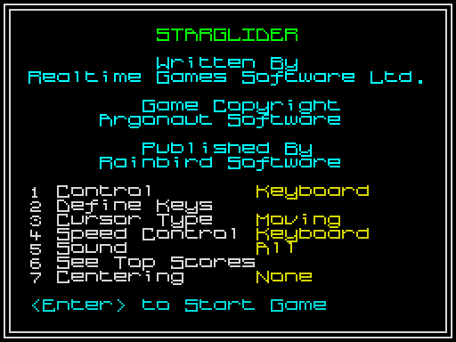
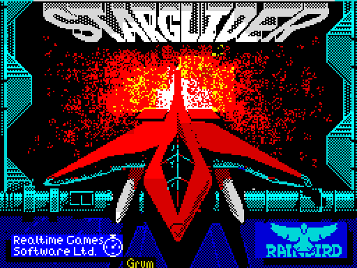
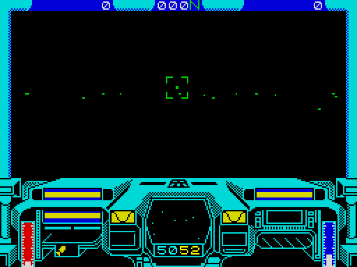
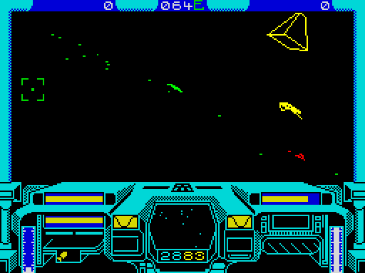
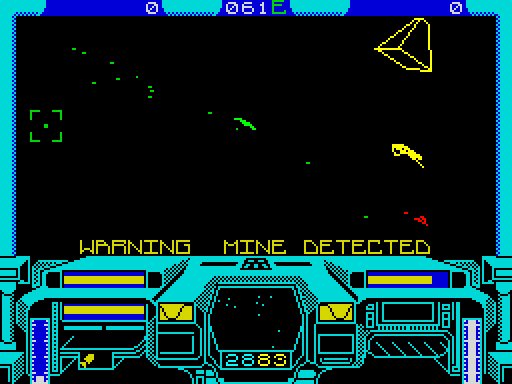
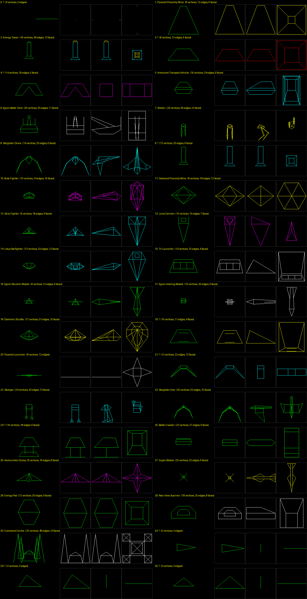

# Starglider on the ZX Spectrum (128K and 48K)

Realtime Games' conversion (Ian Oliver, Graeme Baird; music David Lowe;
speech Clare Edgeley), published by Rainbird in 1986. This is how an 8-bit
machine with a 3.5MHz Z80 ran Argonaut's game. The 128K version is the main
subject: its tape is `original/zx/Starglider128.tap`, which is v.11/86.
Addresses are the Spectrum's, with the 128K bank named where it matters
(bank 5 is always at &4000, bank 2 at &8000, and &C000 holds whichever bank
is paged).

Tags: **[measured]** means run or read from the bytes, with the tool named;
**[source]** gives a link; **[inferred]** is a reading, with what would
check it.

## Summary

| | |
|---|---|
| Versions | 48K v.10/86 and 128K v.11/86 (TZX releases 1 and 2, and the TAPs); 48K and 128K v.1/87 (TZX release 3), a reassembly with a 15-byte guard added in bank 0 **[measured: tapinfo.py on the TZX BASIC; tap2sna.py, then a byte diff]** |
| Protection | No code-card or other check in the game. The tape uses Bleepload: turbo blocks, then a second stage that XORs each main block with its own first 256 bytes (&8000-&80FF) **[measured: disassembly of &80C0-&8117]**. ZXDB lists "Padlock Protection" without saying what it is **[source: https://spectrumcomputing.co.uk/entry/4863/ZX-Spectrum/Starglider]** |
| Game code (128K) | 28,096 bytes: bank 2 &8500-&BFFF (15,104) and bank 0 &C000-&F2BF (12,992), with about 4.5K of text in them. Front end 1,952 bytes (bank 4); title tune and its player 3,250 bytes (bank 6) **[measured: memory at entry, tools/zx_prof.py execution map]** |
| Game (48K) | One 38,144-byte block at &6B00-&FFFF holds everything; running, it uses &5B00-&FFFF **[measured: tapinfo.py; tools/zx.py run]** |
| Tables | 2,048 bytes at &4000-&47FF: two sine tables, a logarithm table, an antilogarithm table, quarter squares, screen line addresses **[measured: disassembly]** |
| Shapes | 36 types, 33 with a shape; 5,654 bytes at &5800-&6E15 (128K), 4,347 bytes in the 48K. A shape is a bounding box plus a vertex program of copies and midpoints. 21 of them are the ST's models rebuilt on that grid (five with the ST's exact counts), not the ST's coordinates **[measured: tools/zx_shapes.py, tools/st_shapes.py]** |
| 3D view | 240 x 120 pixels on screen (30 x 15 character cells), drawn into a 256 x 128 buffer (4,096 bytes and 512 of attributes) **[measured: the copy at &91F7, the plot at &8CFC]** |
| Buffering | One off-screen buffer (bank 7 &E800), copied to the screen by the frame interrupt, timed to trail the raster; then cleared with PUSH. No page flip: the 128K always shows the bank 7 screen and keeps data where bank 5's screen would be **[measured]** |
| Frame rate | Whole frames per pass, from the copy's timestamps, with contention: nothing in view 7.29 (6.9 fps); one object 8.57; two 10.44; three 11.8 (4.2 fps); a mixed session 8.24 (6.1 fps). The 48K is the same within noise **[measured: tools/zx_fps.py --cmio]** |
| Cost per object | 57,000-310,000 T-states to draw one object, most of it maths: about a frame and a half for a typical enemy **[measured: tools/zx_shapes.py, contended]** |
| Line drawer | Bresenham into the buffer: about 85 T-states a pixel when x-major, 95-99 when y-major or diagonal, plus about 600 of set-up; horizontal runs filled a byte at a time **[measured: stub calls of &8D85]** |
| Maths | Sines to 1.7 fixed point (x127), 512 steps a turn; multiplies by quarter squares; the perspective divide by logarithms; X = 128 + 250x/z, about 51° across the view **[measured]** |
| Hidden lines | Back-face culling per object: an edge is drawn if a face listing it faces the viewer. Objects never hide one another **[measured: the game's own drawing in tools/zx_shapes.py]** |
| Colour | One attribute fill for the view (&04: green ink, black paper); each line sets the cells it crosses to bright plus its edge's ink, so the object drawn last wins a cell; objects are drawn in depth order (far to near, inferred) **[measured: attributes in snapshots; &8D85, &A508]** |
| Speech (128K) | 4 phrases, 26,932 bytes of signed 8-bit samples in banks 1 and 3, played at 5,952Hz (4.53 s in all) through three AY volume registers. A phrase stops the game for 104-123 frames, bleeps included **[measured: tools/zx_speech.py]** |
| Music (128K) | David Lowe's tune plays only on the attract screen (the loading picture), after the menu sits idle for about 6 s **[measured]** |
| Sound effects | AY (128K): a shadow of the 14 registers, all written each frame. Beeper in the 48K **[measured: port log]** |
| 128K only | Speech, title music, six special missions and their six shapes (Battle Crawler, Rear View Scanner, Energy Pod, Super Missile, Ammunition Dump, Command Centre), the rear view scanner and super missile keys **[measured: strings and shape tables of both versions]** |

## Loading

### The tapes

`tapinfo.py` lists the blocks **[measured]**:

- **`Starglider48.tap`** is a plain conversion: a BASIC loader, the
  loading screen, then one CODE block, GLIDER-CODE, of 38,144 bytes at
  &6B00 (27392). The program starts with `RANDOMIZE USR 33284` (&8204).
- **`Starglider128.tap`** is a conversion of the Bleepload tape. Its BASIC
  carries the remark "TAP VERSN BY Alexander V.Podzhunas 'aka' BIOTOXIN".
  It loads a 512-byte loader at &BC00 (48128) and patches it to load through
  the ROM. Then come 69 blocks of 268-275 bytes with flag byte 100, each
  ending `JP &BC26`, and seven big blocks of 16,384, 16,384, 15,872, 16,384,
  8,192, 16,384 and 3,250 bytes.
- **The TZX files** are the original tapes. Side 1 is the 48K and side 2 the
  128K: their loaders are at &CD00 (52480) and &BC00 (48128). After the
  standard header and loader come blocks grouped as "Bleepload Group 1", in
  turbo encoding (pilot 2,165 T-states, bits of 856 and 1,712).
  - The BASIC remarks give the versions: v.10/86 (48K) and v.11/86 (128K)
    in releases 1 and 2, and v.1/87 for both in release 3.

### What loads where (128K)

`tap2sna.py` loads the 128K tape by simulation, but it needs a longer
simulated-time limit than its default 900 s, as the ROM-speed tape runs past
it. Stopping at the game's entry gives a snapshot of the game before it
runs **[measured]**:

    .venv/bin/python -I .venv/bin/tap2sna.py -c machine=128 -c timeout=3000 \
        -s 34048 original/zx/Starglider128.tap build/zx128.z80
    .venv/bin/python -I .venv/bin/tap2sna.py -c machine=48 \
        -s 33284 original/zx/Starglider48.tap build/zx48.z80

The load happens in two stages **[measured: tap2sna.py stopped at blocks 5
and 74, memory diffs]**:

1. **The Bleepload blocks** (69 blocks of about 256 bytes) fill bank 7
   &C000-&F2E3 and put a second-stage loader at &B600-&BFFF. The screen
   shown during loading is bank 7's: &7FFD holds &1E, which pages bank 6
   and sets bit 3.
2. **The second stage** at &80C0 walks a table at &81B8. The table has five
   bytes per block: the &7FFD value, then the address and the length. It
   loads seven blocks, each into &C000 of one bank, and XORs each with the
   256 bytes at &8000-&80FF (the loader's own code) as the key. If a block
   fails it pages ROM 0 and jumps to 0. Then it jumps to &8500.

| Block | Bank | Address | Length | Contents |
|---|---|---|---|---|
| 1 | 0 | &C000 | &4000 | Game code &C000-&F2BF; the rest zero |
| 2 | 1 | &C000 | &4000 | Speech phrases 0 and 1 |
| 3 | 2 | &C200 | &3E00 | Game code and text &8500-&BFFF, speech volume tables &8200-&84FF |
| 4 | 3 | &C000 | &4000 | Speech phrases 2 and 3 |
| 5 | 4 | &C000 | &2000 | Front end &C000-&C79F; then the 128K's power-on RAM pattern (64 bytes of &00, 64 of &FF), saved with the bank |
| 6 | 5 | &C000 | &4000 | Tables, variables and shapes (&4000-&7FFF) |
| 7 | 6 | &C000 | &0CB2 | Title tune and its player |

Bank 7 keeps what the Bleepload stage put there: the loading picture
(&C000-&DAFF), the font (&DB00-&DDFF), the missile view's frame graphics
(&DE00-&E71F) and the cockpit (&E800-&F2FF), which start-up draws once
before the area becomes the view buffer **[measured: byte searches of the
in-flight panel in the entry snapshot]**.

### Protection

- No code-card, Lenslok or keyword check was found in either game. There
  are no strings asking for one, and the 128K goes from &8500 to the menu
  and into flight with no input but ENTER **[measured: tools/zx.py; string
  search of every bank]**.
- The protection is the tape: Bleepload's turbo blocks and the XOR-coded
  main blocks **[measured]**. ZXDB's "Padlock Protection" is probably this
  **[inferred; the ZXDB entry gives no detail]**.
- The harness needs nothing special: the TAP loads with tap2sna.py, which
  also loads the three TZX releases' Bleepload blocks.

### The other copies

- **archive.org's `Starglider128.z80`** is the same v.11/86 game, taken
  during the attract screen: PC &C073 is inside the tune's step routine in
  bank 6.
  - Banks 0, 1 and 3 are byte-identical to the TAP's load.
  - Bank 2 differs only in self-modified bytes and the IM 2 table.
  - Bank 5 &4000-&5AFF holds the swapped-in title picture, and bank 6
    &E500 the data swapped out (see "Music") **[measured: byte diff]**.
- **The TZX releases** load with tap2sna.py too.
  - Releases 1 and 2 (128K side) match the TAP except for six loader bytes.
  - Release 3 (v.1/87) is a reassembly: 15 bytes of new code at the start
    of bank 0, `SBC A,A / XOR A / BIT 7,H / RET NZ / ...`, guard a routine
    that runs from &BFxx across into &C000. Everything after it moves up 15
    bytes. The bank 5 changes are the moved routine addresses in the shape
    headers, and bank 4 changes in ten bytes **[measured: difflib over the
    banks]**.
  - This study uses v.11/86.
- **The +3 disc** has no +3DOS directory, so it boots its own format
  **[measured: DSK parse]**. It wasn't examined further.

## Running it headless

`tools/zx.py` is Ninja Massacre's harness (`../nm/tools/zx.py`) with nm's
shared random numbers taken out and two changes **[measured]**:

- **Paging.** SkoolKit's C simulator pages the 128K's banks itself, but its
  Python view of &C000 and `memory.o7ffd` only follow if the tracer pages
  too, as SkoolKit's own `PagingTracer` does. Without that, a snapshot
  saved while bank 0 is paged comes back with the wrong bank and crashes
  into the ROM. `write_port` now calls `memory.out7ffd()`.
- **Screenshots** read the screen that bit 3 of &7FFD selects (bank 7 in
  play, bank 5 on the attract screen).
- `--cmio` runs SkoolKit's contended simulator (CCMIOSimulator), so
  T-states match a real 128K. The figures here use it unless they say not.

Tools written for this study (all run with `.venv/bin/python -I`):

| Tool | What it does |
|---|---|
| `tools/zx.py` | Run a snapshot with scripted keys, frames, screenshots and snapshots |
| `tools/zx_prof.py` | Profile by bank and address, count passes of addresses, write a bank-aware execution map, total T-states in named ranges |
| `tools/zx_fps.py` | Frames per pass of the main loop, against objects and lines drawn (`--48` for the 48K) |
| `tools/zx_steps.py` | T-states a pass of each step of the main loop |
| `tools/zx_shapes.py` | Run the game's object drawer on every type: vertices, edges, faces, the game's own picture, views, a contact sheet |
| `tools/zx_speech.py` | Time the speech player and write each phrase as a WAV (to `build/zx/`, not committed) |
| `disasm/zx128.ctl` | SkoolKit control file for the 64K view with bank 0 paged, with the routines below titled: `sna2skool.py -H -p 0 -c disasm/zx128.ctl build/zx128.z80` |

The screenshots in `docs/images/zx/` came from these scripts **[measured]**:

    tools/zx.py 'f40,!menu,f300,!attract' docs/images/zx/zx128_
    R='X:down,f60,X:up,f100,O:down,f10,O:up,f100,P:down,f30,P:up,f150,O:down,f40,O:up,f100'
    tools/zx.py "f50,ENTER:tap,f250,!flight_empty,$R,$R,$R,X:down,f60,X:up,f100,O:down,f10,O:up,f40,!flight_objects,f10,!flight_mine" docs/images/zx/zx128_

 

 

The silo wasn't reached: docking needs a silo found and flown into, and no
script got there. The silo computer's enemy file was read from its tables
instead (see "The game").

Keys **[source: original/zx/Starglider_KeyboardMap.jpg]**: Q/A altitude, O/P
turn, X/Z faster/slower, SPACE lasers, L missile, R rear view scanner and S
super missile (128K only), BREAK pause. The flight controls are read every
frame by the interrupt (&AC3C calls &90C4), whatever the pass rate
**[measured]**. No missile could be launched from the start of a game; the
player probably has none until a silo loads one ("Missile loaded")
**[inferred]**.

## The memory map (128K, v.11/86)

From the entry snapshot and in-flight snapshots **[measured: tools/zx_prof.py
map; byte maps]**:

| Where | Contents | Size |
|---|---|---|
| Bank 5 &4000-&41FF | Sine tables: &4100 holds sin(n x 2pi/256) x 127; &4000 holds the same half a step on. Cosine is at +&40 | 512 |
| &4200-&43FF | Logarithm table (low bytes, high bytes) for the divide | 512 |
| &4400-&44FF | Antilogarithm table | 256 |
| &4500-&46FF | Quarter squares n^2/4 (low, high) for the multiplies | 512 |
| &4700-&47FF | Screen line addresses in bank 7, 128 lines, built at &8530 | 256 |
| &4800-&49FF | Work space written in flight | 512 |
| &4A00-&4AFF | Depth tree of the objects in view | 256 |
| &4B00-&4BFF | Vertex buffer: 6-byte slots (x, y, z); slots 34-41 are the box corners | 256 |
| &4C00-&55FF | Object table: 128 entries of 20 bytes | 2,560 |
| &5600-&5730 | Variables (&5717-&5724: the AY shadow) | ~300 |
| &5800-&6DCD | Shapes | 5,582 |
| &6DCE-&6E15 | Shape pointer table, by type (36 entries) | 72 |
| &6E16-&7FB1 | Unused (zero) | 4,508 |
| &7FB2-&7FFF | Stack | 78 |
| Bank 2 &8000-&8100, &8181 | IM 2 vector table (I = &80, all &81), and `JP &A86D` | 260 |
| &8200-&84FF | Speech: AY volumes for channels A, B and C per sample value | 768 |
| &8500-&BFFF | Code; the silo computer's enemy file (&8688), mission texts (&B2xx-&BA5x), messages | 15,104 |
| Bank 0 &C000-&F2BF | Code: the 3D engine and the object logic | 12,992 |
| &F2C0-&FFFF | Unused | 3,392 |
| Bank 1 &C000-&FB19 | Speech phrases 0 and 1 | 15,130 |
| Bank 3 &C000-&EE19 | Speech phrases 2 and 3 | 11,802 |
| Bank 4 &C000-&C79F | Front end: menu, high scores, name entry, define keys | 1,952 |
| Bank 6 &C000-&CCB1 | Title tune and its player | 3,250 |
| Bank 6 &E500-&FFFF | Copy of the loading picture (start-up copies it from bank 7) | 6,912 |
| Bank 7 &C000-&DAFF | The screen shown in play | 6,912 |
| &DB00-&DDFF | Font, characters 32-127 | 768 |
| &DE00-&E71F | Missile view frame graphics | ~2,300 |
| &E800-&F7FF | View buffer, 256 x 128 (the cockpit's source before start-up draws it) | 4,096 |
| &F800-&F9FF | View buffer attributes, 32 x 16 | 512 |

Free space: bank 4 after &C79F, bank 3 after &EE19, bank 6 &CCB2-&E4FF,
bank 0 after &F2BF and bank 5 &6E16-&7FB1. That is more than 30K unused in
the 128K version **[measured: the RAM-test pattern and zeros in those
places]**.

**Showing bank 7 frees bank 5's screen.** The paging routine &8549 ORs &18
into every &7FFD write: ROM 1 and bit 3, so the bank 7 screen is shown
throughout play. The 6,912 bytes at &4000 hold the tables and the object
table instead. Only the attract screen swaps them out (see "Music")
**[measured]**.

**Which parts are 128K-only**: speech (banks 1 and 3, the player &8BEF, the
tables at &8200), the tune (bank 6), the special missions and their texts,
and six shapes (5,654 - 4,347 = 1,307 bytes of shapes) **[measured]**.

**The 48K** loads everything at &6B00-&FFFF **[measured]**:

- Its entry (&8204) moves 4K from &E8F0 down to &5B00 and 496 bytes from
  &E700 to &FA00.
- It sets IM 2 with I = &39, the usual vector through the ROM's &FF bytes to
  &FFFF, then `JR` to `JP &AE7F`.
- The shape table is at &6412 and the shapes follow it, to &750C.
- The view buffer is at &DE00-&EDFF, with attributes at &EE00-&EFFF. It is
  copied to the screen at &4000 through a line table at &FD00 (&A3E5).
- The main loop is &B33C-&B38C, waiting at &A6A0.

## The engine

### The main loop and the frame interrupt

The game starts at &8500:

- It fills &8000-&8100 with &81 and puts `JP &A86D` at &8181 for IM 2.
- It copies the loading picture to bank 6 (&9539) and builds the screen
  line table at &4700.
- It goes to &AD2C, the front end (bank 4, `CALL &C24D`) **[measured]**.

The main loop is &AD67-&ADCC. One pass draws one frame of the view.
`tools/zx_steps.py` gives the cost of each step a pass, from the start of a
game with nothing in view, with contention: 6.98 frames a pass, about
495,000 T-states **[measured]**:

| Call | T-states a pass | What it does |
|---|---|---|
| &D173 | 79,500 | Every active object: position relative to the viewer, cull beyond 9,000 units (&2328) in x or z, rotate by the heading (&C3BF), behaviour, scanner (&9795) |
| &D3F9 | 18,000 | The horizon, a dotted line |
| &D9B1 | 97,800 | Ten ground marker dots (table at &DB9B), each rotated and projected. Patching their count (the byte at &D9D6) to 1 removes most of the dots **[measured]** |
| &A508 | 57 (none in view) | Draw the objects in view, in depth order |
| &94C4 | 162,800 | Set &5634 and HALT; the interrupt then copies and clears the view; plus the wait for the frame |
| &9B28 | 22,800 | Panel bars: energy, shields, laser |
| &9D02 | 8,100 | Heading and sector display |
| &E4DA, &DC0E | 18,000, 60,200 | Object loops (movement, collisions) **[inferred from their walk of &4C00]** |
| others | ~25,000 | &9478, &94B6 (clear the vertex buffer), keys (&8FE6), and the rest |

The interrupt handler (&A86D) saves everything and pages bank 7. It calls
&A8A0, then puts the bank back **[measured]**:

- Every frame it reads the controls (&AC3C, &90C4) and runs the sound and
  the missile view.
- When &5634 is set (a pass is done), it first spins in a delay loop at
  &A9F5 (550 x 26 T-states). Then it copies the buffer to the screen
  (&91F7) and clears the buffer (&9299). The missile view uses &92CF and
  &9372 instead.
- That work runs with interrupts off, from 21,600 T-states into one frame
  to about 64,000 into the next, so the interrupt in between is missed. A
  pass always ends on a whole frame.

### Screen, buffer and copy

- **The view is 240 x 120 pixels**: character rows 1-15 and columns 1-30
  of the screen. The top row is the score and heading bar; rows 16-23 are
  the cockpit **[measured: &91F7 copies 15 rows of 30 bytes; screenshots]**.
- **The buffer is 256 x 128**, 32 bytes a line, at bank 7 &E800. The plot
  (&8CFC) and the line drawer address it as y x 32 + x/8. The copy takes
  lines 8-127 and columns 1-30, so the outer 8 pixels on each side, and the
  top 8 lines, are a margin that is drawn into but never shown (or cleared)
  **[measured]**.
- **The copy** (&91F7) pops screen line addresses from the table at &4710.
  For each line it does `INC E` and 30 `LDI`s; for each character row, 30
  `LDI`s of attributes from &F821 to &D821. It costs 84,000-86,000 T-states
  with contention, 72,000 without **[measured: zx_prof.py ranges]**.
- **The clear** (&9299) does 120 x 16 `PUSH HL` of zero over &E900-&F7FF,
  then fills the attributes &F800-&F9FF with the value at &5710: 30,900
  T-states **[measured]**.
- **Raster timing.** The copy starts 21,600 T-states after the interrupt.
  The beam reaches the view's top line at 16,188 (63 border lines and 8
  screen lines of 228 T-states), so it is already 24 lines into the view.
  The copy then moves at about 720 T-states a line against the beam's 228.
  - In that field the beam stays ahead of the copy and shows the whole old
    view. In the next field it starts 91 lines behind the copy and doesn't
    catch it in 120 lines, so it shows the whole new view.
  - So there is no tearing, at the cost of a frame of latency **[measured:
    timings; inferred: the picture, which a raster-accurate emulator would
    show]**.
- **No page flip.** The 128K's two screens aren't used for double
  buffering. The game keeps one off-screen buffer and copies it, as the 48K
  does with its buffer at &DE00 **[measured]**.

### Frame rate

`tools/zx_fps.py` counts the whole frames from one copy to the next, for
each pass, with the objects (calls of &D3AC) and lines (calls of &8D85)
drawn in that pass. This run is a flight from the start of a game: turning,
speeding up and firing, 2,480 frames, with contention **[measured]**:

| Objects drawn | Passes | Frames a pass (min, mean, max) | Lines a pass |
|---|---|---|---|
| 0 | 140 | 7, 7.29, 10 | 0.3 |
| 1 | 122 | 7, 8.57, 11 | 12.3 |
| 2 | 34 | 8, 10.44, 12 | 30.2 |
| 3 | 5 | 11, 11.80, 13 | 54.8 |
| All | 301 | 8.24 (6.07 passes a second) | |

- Without contention the same run averages 7.63 frames a pass.
- The 48K, on the same keys, gives 7.25, 8.36 and 9.94 frames for 0, 1
  and 2 objects, and 8.26 overall **[measured: tools/zx_fps.py --48 --cmio]**.
- The CPC conversion measures 8.3 frames an update in quiet flight
  (`docs/research/cpc.md`).
- Speech stops everything for 104-123 frames (see "Sound").

Busier scenes than three objects didn't come up in free flight. Drawing
each shape on its own gives a cost model instead (see "Shapes"): a typical
enemy costs 80,000-130,000 T-states, a frame and a half. Five objects in
view would take about 15 frames a pass, 3.3 fps **[inferred from the
per-object costs; a scripted flight into a group would check it]**.

### Where the time goes, by primitive

The same flight, 300 frames, with contention **[measured: zx_prof.py
--ranges]**:

| Primitive | T-states a call | Calls a pass | Share |
|---|---|---|---|
| Copy view to screen (&91F7) | 85,800 | 1 | 13.7% |
| 16 x 8 multiply (&BE03) | 459 | 187 | 13.7% |
| Clear view (&9299) | 30,900 | 1 | 4.9% |
| Lines (&8D85) | 1,287 (short lines) | 16 | 3.2% |
| Divide for x (&BE70) | 616 | 26 | 2.6% |
| 8 x 8 multiply, high byte (&BDC2) | 193 | 71 | 2.2% |
| Divide for y (&BF1E) | 336 | 26 | 1.4% |
| Plot (&8CFC, with paging) | 563 | 14 | 1.3% |

### The line drawer

&8D85 is a Bresenham drawer into the buffer **[measured: disassembly; stub
timings]**:

- It takes the ends as H = y, L = x and D = y, E = x, and draws left to
  right.
- It keeps the current byte in A and writes it only on leaving the byte or
  the line.
- Each attribute cell it crosses gets the ink at &5632, which is patched
  into its `LD (IX+0),n` instructions. IX runs through the attribute buffer
  at &F800.
- A horizontal line is filled a byte at a time (`LD (HL),&FF`).

| Line | T-states a pixel (contended) | Set-up |
|---|---|---|
| x-major, shallow | 86.9 | ~650 |
| y-major, steep | 98.4 | ~570 |
| Diagonal | 98.9 | ~670 |
| Horizontal | 4.6 | ~800 |

### Maths

**[measured: disassembly of &BD8F-&BFFF, &C240-&C352; tables read]**

- **Angles.** The viewer's heading (&56B0), pitch (&56B2) and roll (&56B4)
  are 9-bit: bit 0 picks the table (&41xx or the half-step &40xx), bits 1-8
  index it, so 512 steps a turn. An object's yaw (+8) is 8-bit, added to
  the index.
- **Sines** are signed bytes, x127 (1.7 fixed point). Sine and cosine pairs
  are kept at &56F2-&56FB.
- **Multiplies** use quarter squares: ab = f(a+b) - f(a-b), with f(n) =
  n^2/4 in the 16-bit table at &4500/&4600. `JP PE` picks the other form
  when a+b overflows.
  - &BD8F: signed 8 x 8 to 16 bits, halved.
  - &BDC2: signed 8 x 8, rounded high byte.
  - &BE03: signed 16 x 8, from two 8 x 8 products.
- **The perspective divide** (&BE70 for x, &BF1E for y) normalises z and x
  by shifting, counting the shifts. It looks up both logarithms
  (&4200/&4300), subtracts, takes the antilogarithm (&4400), and shifts
  back by patching a jump into a run of `ADD HL,HL`.
- **Projection** (&C08B): X = 128 + Kx/z and Y = 64 + Ky/z, with K about
  250. Vertices behind the viewer (z negative) get &8000. So the 240-pixel
  view spans about 51° across and 27° up and down. The centre (128, 64) is
  3.5 lines above the window's middle **[measured: zx_shapes.py, the median
  of 404 projected vertices]**.
- **Coordinates** are 16-bit throughout: world x and z in the object table
  (+1, +5), and camera-space x, y, z in the vertex buffer.

### Objects: cull, transform, sort, draw

**[measured: &D173, &A508, &D3AC, &D2EE, &D304]**

1. **&D173** walks the object table (128 entries of 20 bytes at &4C00; the
   count is at &56FC; bit 0 of +0 means active).
   - Objects further than 9,000 units from the viewer in x or z are
     dropped.
   - The rest are rotated by the heading (&C3BF) into view space, with
     camera x, y, z at &56E9, &56EB and &56ED.
2. Objects in view go into a binary tree at &4A00, keyed on depth.
   **&A508** walks it in order and calls **&D3AC** for each. Drawing far to
   near lets the nearest object's colour win the attribute cells, which is
   the only reason a wireframe game would sort **[inferred: the walk order
   was read, its direction against depth was not checked]**.
3. **&D3AC** takes the object's type (+9). Type &20 goes to &D7B8, a
   compound object that looks up two others through a table at &D95F; what
   it shows wasn't identified. Any other type is looked up in the shape
   table at &6DCE.
4. **&D2EE** calls the shape's **basis routine**, named by the shape's
   first two bytes, with its size bytes. The routine builds the object's
   rotated axes from the viewer's angles and the object's yaw, scales them
   by the sizes, and puts the eight corners of the bounding box in vertex
   slots 34-41 (&C6AA).
5. **&D304** runs the shape's vertex program (&D0DA) and projects the
   vertices (&C08B). Then it draws the always-drawn edges (&CE9F), tests
   the faces (&C111), marks the edges of the faces that face the viewer,
   and draws the marked edges (&CE8B).
6. **Each edge** (&CEC0) gets its ink, then is clipped (&CF33) and drawn.
   - Clipping works on 16-bit screen coordinates, with y doubled so that
     both axes have the range 0-255.
   - A line with both ends off the same side is dropped. A line with both
     ends inside goes straight to the drawer.
   - Otherwise the line is split at its midpoint (add and halve), again and
     again: there are no divides.

### Hidden lines

- **Back-face culling, per object.** Each face names three vertices for the
  facing test and the edges it owns. An edge is drawn if any face that
  lists it faces the viewer. The game's own renders in
  `docs/images/zx/shape_NN.png` (left of each tile) show the hidden edges
  missing **[measured]**.
- Some shapes also have always-drawn edges: the drone, the missiles, the
  Stomper, Starglider One and the Pyramid Launcher (which has no faces).
- **Objects don't hide one another**: each object's lines go on top of
  whatever is drawn already. This matches the manual's "translucent
  display of anything within its visual range, even if objects are behind
  solid buildings" **[measured: the drawer ORs into the buffer;
  source: original/zx/Starglider.txt]**.

## Shapes

`tools/zx_shapes.py` puts a made-up object straight ahead of the viewer,
with every angle zero, and calls the game's own &D3AC from a stub
**[measured]**:

- It reads the camera-space vertices at &D307 (after the vertex program)
  and the projected ones at &D314.
- It parses the edge and face lists.
- It times the whole call, with contention, at the distance where the
  shape fills about half the window.
- It saves the game's own picture of the shape from the buffer.

### Format

**[measured: &D2EE, &D0DA, &D304, &CEC0]**

| Part | Bytes |
|---|---|
| Basis routine | 2: its address in bank 0 (&C798 builds a plain box; others add animation, like the walker's legs from &C8CF, or special bases) |
| Sizes | 1-3 bytes, the box's half-sizes (for example `46 1E 1E` = 70, 30, 30) |
| Vertex program | A count, then that many op bytes. Bits 7-6 are the op, bits 5-0 the slot (6 bytes at &4B00 + 6 x slot). **00** load the slot into the current point; **01** store the current point in the slot; **10** current = (current + slot)/2; **11** current = current + slot |
| Projected vertices | A count P: slots 0..P-1 are projected |
| Always-drawn edges | A count, then two bytes an edge. Bits 7-2 are the vertex slot x 4. Bit 1 of the first byte and bits 1-0 of the second are the ink, 0 meaning the object's own (bits 7-5 of its +0) |
| Culled edges | The same, for edges drawn only when a face lists them |
| Faces | A count. Each has three vertex bytes for the facing test, an edge count, and that many edge offsets (2 x edge number) into the culled list |

So a shape is built from its box, not stored as points. Only the box's
axes are rotated and scaled: three vectors, a few multiplies. Every other
vertex costs an add or an add-and-halve. The coordinates lie on a dyadic
grid inside the box: halves, quarters and eighths of the half-sizes. The
CPC conversion has the same format (`docs/research/cpc.md`) **[measured]**.

### The shapes

All 36 table entries **[measured: tools/zx_shapes.py; names from the silo
computer's file at &8688 and the mission targets at &B434]**:

| Type | Name | Vertices | Edges (always + culled) | Faces | Bytes | Draw T-states |
|---|---|---|---|---|---|---|
| 0 | (energy beam between towers, by the ST match: two segments 196 long, 3,930 apart; 3 at the start) | 4 | 2 + 0 | 0 | 12 | 21,371 |
| 1 | Pyramid Proximity Mine | 8 | 0 + 12 | 6 | 109 | 77,640 |
| 2 | Energy Tower | 16 | 0 + 28 | 13 | 219 | 116,545 |
| 3 | (red truncated pyramid; 24 of them at the start) | 8 | 0 + 12 | 5 | 96 | 57,096 |
| 4 | (magenta arch) | 14 | 0 + 18 | 5 | 140 | 84,615 |
| 5 | Armoured Transport Vehicle | 16 | 0 + 24 | 9 | 193 | 93,791 |
| 6 | Egron Battle Tank | 20 | 2 + 23 | 11 | 222 | 123,995 |
| 7 | Walker | 20 | 0 + 36 | 22 | 315 | 162,217 |
| 8 | Starglider Drone | 14 | 10 + 10 | 6 | 145 | 132,116 |
| 9 | (tower, smaller than type 2) | 12 | 0 + 20 | 9 | 156 | 84,183 |
| 10 | Bute Fighter | 10 | 0 + 24 | 16 | 215 | 104,372 |
| 11 | Diamond Proximity Mine | 8 | 0 + 18 | 12 | 158 | 113,730 |
| 12 | Skim Fighter | 9 | 0 + 18 | 9 | 144 | 85,127 |
| 13 | Juno Cannon | 10 | 0 + 15 | 7 | 125 | 82,166 |
| 14 | Lotus Starfighter | 13 | 0 + 23 | 12 | 201 | 102,641 |
| 15 | Tri Launcher | 14 | 0 + 15 | 4 | 136 | 93,743 |
| 16 | Egron Neutron Missile | 9 | 3 + 9 | 6 | 108 | 63,843 |
| 17 | Egron Homing Missile | 15 | 4 + 16 | 9 | 171 | 86,318 |
| 18 | Diamonic Shuttle | 17 | 0 + 31 | 15 | 250 | 128,507 |
| 19 | (the silo, by the ST match: a yellow sloped building) | 10 | 0 + 11 | 4 | 96 | 69,787 |
| 20 | Pyramid Launcher | 8 | 12 + 0 | 0 | 58 | 80,399 |
| 21 | (cyan building) | 12 | 0 + 22 | 12 | 190 | 117,749 |
| 22 | Stomper | 24 | 6 + 27 | 13 | 270 | 180,263 |
| 23 | Starglider One | 20 | 6 + 26 | 15 | 254 | 161,928 |
| 24 | (a slab on legs over a base) | 16 | 6 + 12 | 6 | 137 | 94,619 |
| 25 | Battle Crawler (128K mission) | 22 | 0 + 27 | 9 | 229 | 114,640 |
| 26 | Ammunition Dump (128K mission) | 9 | 0 + 16 | 8 | 131 | 81,351 |
| 27 | Super Missile (128K mission) | 25 | 16 + 16 | 9 | 221 | 136,135 |
| 28 | Energy Pod (128K mission) | 12 | 0 + 20 | 9 | 162 | 89,026 |
| 29 | Rear View Scanner (128K mission) | 18 | 0 + 25 | 8 | 182 | 98,472 |
| 30 | Command Centre (128K mission) | 25 | 0 + 48 | 24 | 370 | 309,332 |
| 31 | (no basis routine: &0000) | | | | 111 | |
| 32 | (drawn by &D7B8, not from the table) | | | | 14 | |
| 33-35 | (single triangles: probably explosion fragments) | 3 | 3 + 0 | 0 | 14 each | 27,688-31,497 |

- Each tile shows the game's own render on the left, then front, side and
  top views of every edge. Inks are the edges' own.
- Drawing time doesn't fall with distance. Six shapes drawn at 4 and 12
  times that distance cost from 0.5 to 1.8 times as much. The divides'
  normalising shifts vary, and perspective lets more faces pass the test
  **[measured: zx_shapes.draw at 5, 20 and 60 times each half-size;
  inferred: the reasons]**.

**Across versions** **[measured: byte comparison of the shape records]**:

- The 48K has 30 types. Types 0-24 are byte-for-byte the 128K's, as is the
  table's no-shape entry (128K type 31, 48K 25) and the four small ones.
  Only the basis routine addresses differ. The six mission shapes are the
  only addition in the 128K.
- The CPC has the same records for types 0-24, plus three of the six
  mission objects (Super Missile, Energy Pod, Rear View Scanner), with the
  same counts and record sizes (`docs/research/cpc.md`, `docs/images/cpc/shapes/shapes.md`).

**Against the ST** **[measured: `tools/st_shapes.py --json` on a fresh
extraction of `AUTO/STAR.PRG`, compared with `build/zx/shapes128.json`]**:

- Each shape pair was centred on its bounding box and scaled to it per
  axis, trying the axis sign flips. The error is the root mean square
  distance from each vertex to the nearest vertex of the other shape, in
  units of the box's half-size, taken both ways.

| Spectrum type | ST shape (st.md) | Counts, Spectrum vs ST (vertices/edges/faces) | Error |
|---|---|---|---|
| 0 | 11, the energy beam between towers | 4/2/0 vs 4/2/1 | 0.00 |
| 1 Pyramid Proximity Mine | 2 | 8/12/6, the same | 0.03 |
| 2 Energy Tower | 4 | 16/28/13, the same | 0.05 |
| 16 Egron Neutron Missile | 24 | 9/12/6 vs 9/15/7 | 0.06 |
| 5 Armoured Transport Vehicle | 8 | 16/24/9 vs 16/28/13 | 0.10 |
| 14 Lotus Starfighter | 21 | 13/23/12, the same | 0.11 |
| 15 Tri Launcher | 23 | 14/15/4 vs 18/21/4 | 0.14 |
| 12 Skim Fighter | 16 | 9/18/9 vs 10/22/14 | 0.15 |
| 17 Egron Homing Missile | 25 | 15/20/9 vs 15/22/10 | 0.18 |
| 22 Stomper | 15 | 24/33/13 vs 28/43/21 | 0.18 |
| 18 Diamonic Shuttle | 19 (unnamed on the ST) | 17/31/15 vs 17/34/19 | 0.20 |
| 19 (silo entrance) | 18, the silo | 10/11/4 vs 12/13/5 | 0.21 |
| 9 (tower) | 4, the Energy Tower | 12/20/9 vs 16/28/13 | 0.21 |
| 10 Bute Fighter | 13 | 10/24/16 vs 10/23/15 | 0.23 |
| 13 Juno Cannon | 20 | 10/15/7, the same | 0.23 |
| 7 Walker | 1 | 20/36/22 vs 22/42/28 | 0.24 |
| 23 Starglider One | 27 | 20/32/15 vs 24/41/19 | 0.30 |
| 11 Diamond Proximity Mine | 14 | 8/18/12 vs 10/24/16 | 0.31 |
| 3 (red, 24 of them) | 3, the flat red box (20-27 a level) | 8/12/5 vs 8/12/6 | 0.33 |
| 6 Egron Battle Tank | 9 | 20/25/11 vs 24/38/16 | 0.42 |
| 8 Starglider Drone | 7 | 14/20/6 vs 16/30/16 | 0.56 |

- **So the Spectrum's models are the ST's, rebuilt.**
  - Five have the ST's exact counts, and the energy beam is the same
    shape.
  - Most of the rest lost a few vertices and edges: the Walker 22 to 20
    vertices, the tank 24 to 20, Starglider One 24 to 20, the drone 16 to
    14, the Stomper 28 to 24.
  - The coordinates aren't the ST's. Every vertex was moved onto its box's
    dyadic grid, and many boxes were re-proportioned: the pyramid mine is
    0.75 as high as wide on the ST and 1.0 on the Spectrum.
- No ST shape is a close match for type 4 (a magenta arch: ST shape 5 or
  17?), type 20 (the Pyramid Launcher, which the Spectrum draws as a flat
  star of 12 always-drawn edges; the ST's has 8 vertices, 12 edges and one
  face), type 21 or type 24, nor for the six 128K mission shapes. Those
  last are the Spectrum's own.
- The ST shapes the Spectrum lacks: the Walker copy (10), the unused 6,
  the silo tunnel for the docking interior (22) and the 3D GAME OVER (28).
- The ST animates seven shapes by swapping vertex blocks (the Walker's 16
  frames, the drone's wings, and others). The Spectrum animates only the
  Walker's legs (&C84A, four positions at &C8CF) **[measured: basis
  routines; inferred: no other animation found]**.
- Scale: ST units are 12-60 times the Spectrum's, depending on the shape,
  since each Spectrum box was sized on its own.

## The game

**[measured: strings and tables; inferred where marked]**

- **The world**: 128 object slots, 102 of them active at the start of a
  game, with 16-bit x and z covering 0-65535. The manual's 100 x 100
  sectors would be 655 units each **[inferred]**. At the start there are 24
  of type 3, 7 Pyramid Launchers, 6 each of Pyramid Mines, transports,
  tanks, walkers and type 9 towers, and fewer of the rest.
- **The silo computer's enemy file** (&8556, records at &8688) has 18
  entries, each with a type, a viewing distance, a height, a name and two
  lines of text. They are: Pyramid Proximity Mine, Diamond Proximity Mine,
  Walker, Energy Tower, Starglider Drone, Armoured Transport Vehicle, Egron
  Battle Tank, Egron Neutron Missile, Bute Fighter, Stomper, Skim Fighter,
  Juno Cannon, Lotus Starfighter, Tri Launcher, Pyramid Launcher (its text
  says the file has been erased), Egron Homing Missile, Diamonic Shuttle,
  Starglider One.
- **Missions (128K)**: "URGENT. Report to nearest Depot for mission
  briefing." There are six, with a target table at &B434. Each record is
  seven bytes: type, distance, height and a name pointer. The targets:
  1. "Egron Battle Crawler approaching ... Recommend immediate destruction"
     (type 25).
  2. A rear view scanning system to retrieve (29).
  3. An Auxiliary Inductive Energy Pod (28).
  4. The Enhanced Mk.16 Proton Missile, "collect personally" (27).
  5. A large Egron construction, "primary munitions" (26).
  6. A new Egron Command Centre, "of highest priority" (30).
  - Results: "Mission Complete", "Mission Failed", "Mission Cancelled".
- **Other messages**: LEVEL n, WARNING MINE DETECTED, MINE HAS JUST
  EXPLODED!, ENERGY CELLS REFUELLING, Docking Complete, Lasers and Shields
  replenished, Missile loaded, POWER DRAINAGE TOO GREAT (energy, &56B8,
  reached zero), SHIELD DEPLETED / AGAV DESTROYED (shields, &56BB), GAME
  ABORTED, Action Replay, MISSILE VIEW, Front View / Rear View.
- **The 48K cuts** the missions and their texts and shapes, the rear view
  scanner and super missile, speech, the tune, and the AY. It keeps the
  silo computer (Interrogate Computer), docking, levels, Action Replay and
  the missile view. Its menu's Sound option is On/Off, against the 128K's
  All/None/Effects/Speech **[measured: string search of both]**.

## Sound

### Speech (128K)

`tools/zx_speech.py` calls the game's player for each phrase on the
contended simulator, and writes the phrases as WAVs to `build/zx/`
**[measured]**:

| Phrase | Bank, address | Samples | Length | Played when |
|---|---|---|---|---|
| 0 | 1, &C000-&DB99 | 7,066 | 1.19 s | The missile view opens (&ABD1) |
| 1 | 1, &DB9A-&FB19 | 8,064 | 1.35 s | In the silo, with "M for Mission Briefing" (&B21C) |
| 2 | 3, &C000-&D799 | 6,042 | 1.02 s | Shields (&56BB) first fall below &0100 (&9BC5) |
| 3 | 3, &D79A-&EE19 | 5,760 | 0.97 s | Energy (&56B8) first falls below &0400 (&9B78) |

The words aren't known: listen to `build/zx/zx_speech_N.wav`. The ST's four
clips play on the same four events in the same order (missile launched,
docked and rearmed, shields low, energy low: `docs/research/st.md`), so the
phrases are probably the same lines **[inferred]**.

How the player works **[measured: &8BEF-&8C8B]**:

- **It is only reached if speech is on** (&5673, from the Sound option).
  Its caller turns interrupts off.
- **First the bleeps**: the AY's tone A plays two short notes at periods
  &C8 and &190, each stepping through six volumes with delays (&8CAA),
  then a further delay.
- **Then the samples.** The table at &8C92 gives each phrase's start,
  length, delay count (15) and bank. Each sample byte is shifted right
  arithmetically, &40 is added, and the result indexes three 256-byte
  tables at &8200, &8300 and &8400. Those give the volumes of channels A,
  B and C, written to registers 8-10. All tones and noise are off
  (register 7 = &3F), so the three volumes sum to an output level, using
  the AY's logarithmic steps.
- **596 T-states a sample** with contention, 5,952Hz; 577 without
  (hand count).
- **The whole call takes 7.35-8.73 million T-states**, 104-123 frames, with
  the game stopped.

Speech in all: 26,932 bytes of samples, plus the 768-byte volume tables.

### Music (128K)

- David Lowe's tune and its three-channel player are in bank 6,
  &C000-&CCB1 (3,250 bytes).
- **It only plays on the attract screen.** The menu (bank 4) counts 10,000
  polls of the keyboard, about 303 frames, then calls &958B
  **[measured: tools/zx_prof.py pass count]**. That routine:
  - swaps bank 5's &4000-&5AFF with the loading picture saved in bank 6
    &E500;
  - flips the paging routine's OR mask (&854E) to show bank 5;
  - calls &C000 in bank 6, which plays until a key is pressed;
  - swaps everything back.
- **The player isn't interrupt-driven.** Its step routine (&C071)
  decrements a counter of 100 and moves the tune on when it runs out: about
  147 steps a second, set by the loop's speed. Interrupts are off
  **[measured: --pass 6:C083]**.
- Channels B and C each have a note list. A note is a pair of period
  bytes (registers 2-3 or 4-5) and a duration, looked up through a pointer
  table at &C533. A volume list comes through a pointer table at &C585 and
  is written to register 9 or 10 a step at a time. Channel A plays lists
  of register and value pairs (&C195), through the same &C533 table.

### Effects

- **128K**: the effects keep a shadow of the AY's 14 registers at
  &5717-&5724. &A590 writes all 14, nearly every frame in flight
  **[measured: port log]**.
- **48K**: the beeper (`OUT (&FE)`), with no AY code.
- `../nm` and kieranhj's arkos-player-bbc cover AY-to-SN conversion.

## Colour

**[measured: attributes read from in-flight snapshots; &8D85, &CEC0]**

- **The view**: the clear fills its attributes with the value at &5710,
  &04 in play: green ink on black paper, not bright. The ground dots,
  horizon and sight are green.
- **Each edge** sets &5632 to &40 (bright) + paper x 8 (paper from &5711,
  0 in play) + its ink. The ink is the edge's own, or the object's (bits
  7-5 of +0). The line drawer writes that attribute into every cell it
  crosses.
  - In a frame with a walker the view's 450 cells were 434 at &04, 15 at
    &46 (bright yellow) and 1 at &45 (bright cyan).
  - Two objects in one cell take the colour of the one drawn last, which
    should be the nearer **[inferred]**. Clash happens a cell at a time.
- **The cockpit**: rows 16-23 are mostly cyan on black (&05: 212 of 256
  cells), with &0E, &06, &07, &0F, &17, &30 and a few bright cells for the
  meters. The frame round the view is &0D, &05 and &0F.
- **The top row** is the score and heading bar: blue paper, white digits,
  and the heading letter in green.

## Differences from the ST

From `docs/research/st.md` (the ST's figures) and this study (the
Spectrum's) **[source: docs/research/st.md; measured: the Spectrum
figures]**:

| | ST | Spectrum 128K |
|---|---|---|
| Shapes | 28 shapes, 33,864 bytes with animation frames; 8-byte vertices (a cube is ±2048) | 33 shapes, 5,654 bytes; boxes and vertex programs, rebuilt from the ST's (see "Shapes") |
| Animation | Seven shapes swap vertex blocks each frame | The Walker's legs only |
| Hidden lines | Back-face culling per face; objects see-through | The same |
| Line colour | One colour per object (the shape's face colour) | One attribute per edge, but 27 shapes use a single ink; the Energy Tower uses two |
| Buffering | Two screens, swapped every frame | One buffer, copied behind the raster |
| View | The window 16-303 x 10-128; x' = 128x/z + 143 (about 97° across, worked out from those) | 240 x 120; X = 128 + 250x/z (about 51° across): a narrower view |
| Clipping | Near plane z = 2 in 3D, then 2D to the window | Points behind the viewer dropped (&8000), then 2D clipping by midpoint subdivision |
| Frame rate | 2-6 VBLs a frame, 13.5 fps on average | 7-13 frames a pass, 6.1 passes a second on average |
| Speech | Four clips, 27,136 bytes at 6,144Hz, by Timer A interrupt: missile launched, docked and rearmed, shields low, energy low; the warnings repeat every 128 frames while low | Four phrases, 26,932 bytes at 5,952Hz, in a busy loop with the game stopped, on the same four events in the same order; each warning plays once as the level falls below its threshold |
| Music | Sampled title song, 179,200 bytes | An AY tune in bank 6 on the attract screen |
| Missions | Not described in st.md | Six special missions (128K only) |
| Silo computer | 17 names in the Interrogate list (st.md's shape table) | 18 entries: the same, plus "Diamonic Shuttle" for the ST's unnamed shape 19 |

- **Speech recordings.** The Spectrum's phrases differ in length from the
  ST's clips: 7,066, 8,064, 6,042 and 5,760 samples against 7,030, 7,348,
  5,654 and 6,842. They aren't byte copies. Their amplitude envelopes
  correlate at only 0.4-0.7 with the ST's, which doesn't tell whether
  they are the same recordings resampled and edited **[measured: numpy
  cross-correlation of 200Hz envelopes]**. Listening would.
- **The view.** The Spectrum's angle of view is half the ST's, if st.md's
  projection constant is in the same units as its window. That matters
  for a port that copies one or the other's look **[measured: Spectrum;
  source: st.md]**.

## Open questions

- **The ST shapes with no close Spectrum match** (Spectrum types 4, 20,
  21 and 24) need a closer look, and the ST's names for the unnamed types.
- **What the four phrases say**: listen to the WAVs.
- **Frame rate with five or more objects in view**: needs a scripted
  flight into a group, or objects placed by poking the object table.
- **The draw order's direction** (far to near) is inferred: check the tree
  insertion in &D173.
- **Types 3, 4, 9, 21 and 24** are unnamed. The ST match names type 0
  (the energy beam between towers) and type 19 (the silo); type 3 is the
  ST's flat red box, placed 20-27 a level there.
- **The silo interior** wasn't reached; neither was "Action Replay".
- **Release 3 (v.1/87)**: what its 15-byte guard fixes, and whether a port
  should follow it. Its 128K side loads with the same tap2sna.py command
  (`Starglider - Release 3 - Side 2.tzx`).
- **The +3 disc's** custom format and whether it's another build.
- **The raster claim** (no tearing) is from T-state timings; a
  raster-accurate emulator would confirm it.
